# Complete visual gallery

All **40 figures and seven animations** from the five completed milestones are collected here. Earlier visualizations stay in this cumulative gallery as the project advances. SVG versions and the retained animation review frames are linked alongside the figures.

[Current project status and reproduction commands](README.md)

| Milestone | Figures | Animations |
| :-- | --: | --: |
| [01 · Trajectory tracking](#milestone-01-trajectory-tracking) | 11 | 2 |
| [02 · Obstacle-aware navigation](#milestone-02-obstacle-aware-navigation) | 11 | 2 |
| [03 · Sensing and localization](#milestone-03-sensing-and-localization) | 6 | 1 |
| [04 · Landmark mapping and SLAM](#milestone-04-landmark-mapping-and-slam) | 6 | 1 |
| [05 · Decision-making and exploration](#milestone-05-decision-making-and-exploration) | 6 | 1 |

## Milestone 01: Trajectory tracking

[Full milestone walkthrough](MILESTONE_01.md)

The same navy, pale-blue, cyan, and amber theme and the same two-wheel rover geometry appear throughout. Cyan solid denotes feedback, amber dashed denotes open loop, and pale dotted denotes the reference. Spatial scenes use equal aspect ratios; paired scenes share fixed bounds. Figure 01 is a labelled conceptual diagram. All empirical plots use saved data.

### Model and numerical foundations

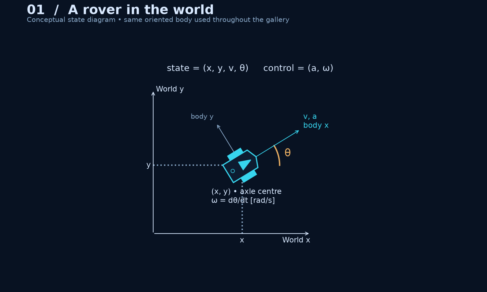

**01 · Robot geometry and state.** The axle centre defines (x, y), heading rotates body axes into the world, and velocity follows the forward body axis. The body and wheels provide orientation cues; no sensors are implied. [SVG](media/01_robot_geometry.svg).

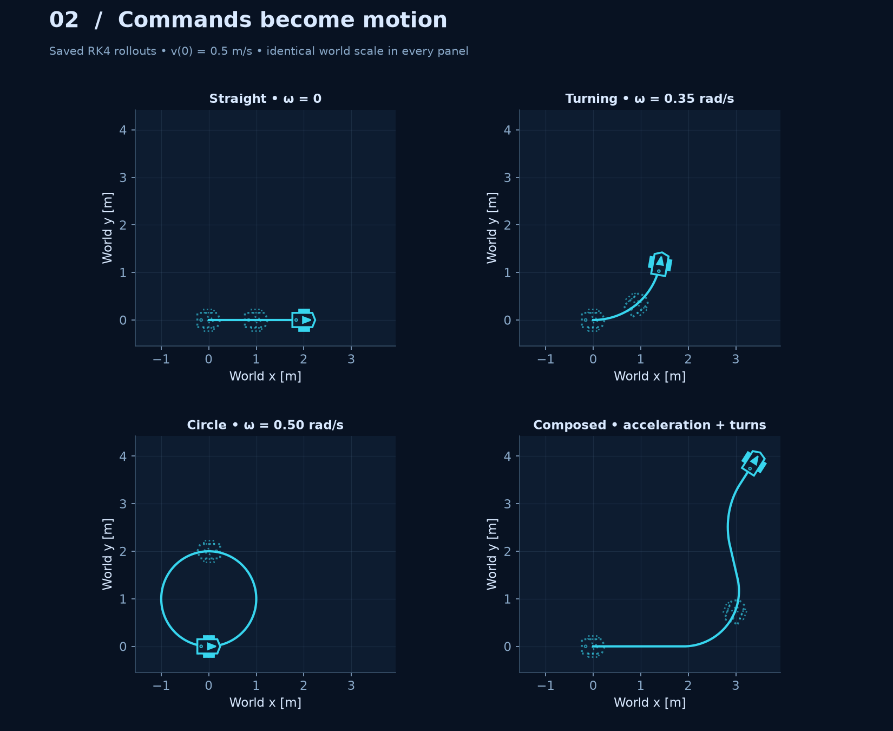

**02 · Motion primitives.** Four saved dynamics rollouts show how straight travel, constant turning, a full circle, and a sequence of acceleration/turn commands build motion. Each panel uses the same world scale.

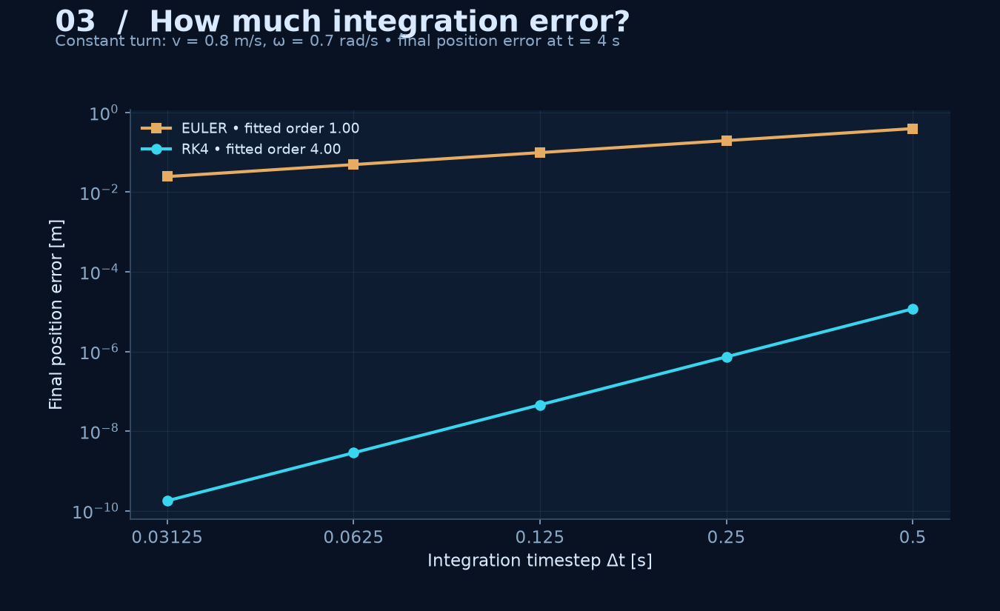

**03 · Integration accuracy.** Error against an analytical constant-turn solution falls approximately linearly for Euler and with the fourth power of timestep for RK4. This isolates integration error from controller sampling. [SVG](media/03_integration_accuracy.svg).

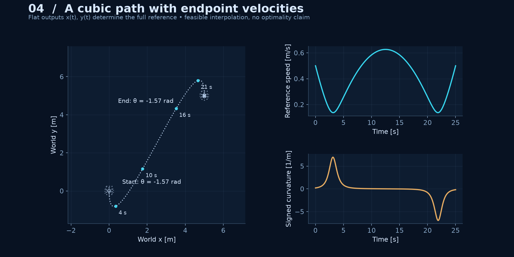

**04 · Reference construction.** Endpoint positions and Cartesian velocities determine two cubics. Their derivatives determine speed, heading, and controls through differential flatness. The initial downward motion and final overshoot follow from the prescribed downward endpoint headings. [SVG](media/04_reference_construction.svg).

### Execution and recovery

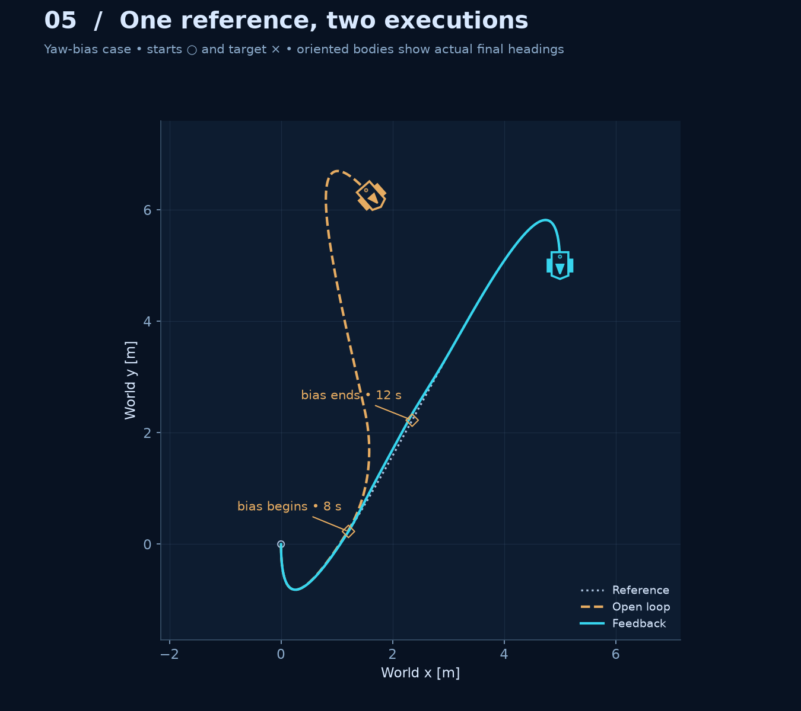

**05 · Full trajectory comparison.** Diamonds locate the reference at disturbance onset and removal. The actual final bodies reveal how much orientation error open loop retains. [SVG](media/05_trajectory_comparison.svg).

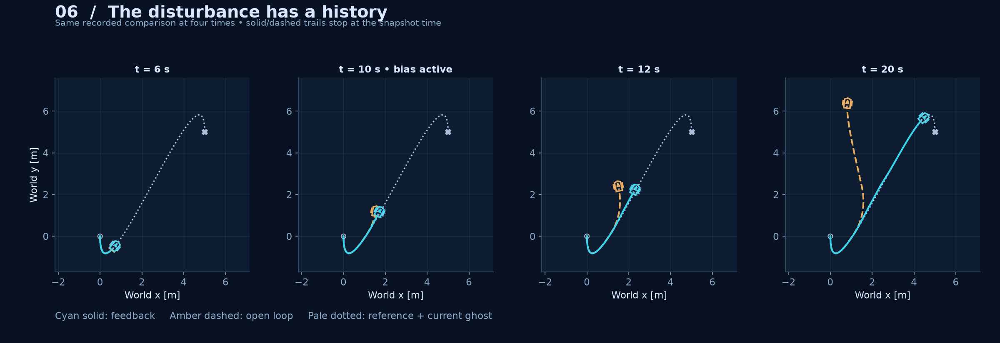

**06 · Temporal progression.** The same run at 6, 10, 12, and 20 seconds. Histories stop at each snapshot time; none is an independently simulated scene. The disturbance interval is half open, so it is inactive at 12 seconds.

**Diagnostic replay.** A moving cursor ties physical motion to error and control activity. The vertical range stays fixed and the traces reveal only recorded history. [Representative frame during the disturbance](media/diagnostic_replay_during.png).

### Diagnose the behavior

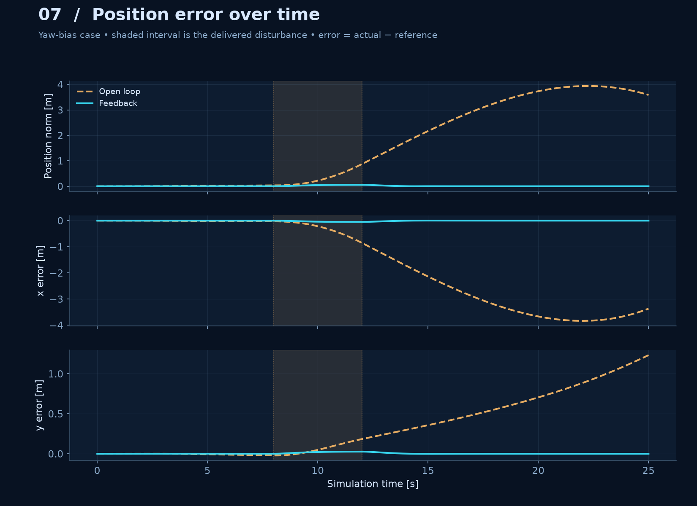

**07 · Position tracking.** Open loop keeps its original commands after the yaw disturbance rotates the rover; position error accumulates. Feedback introduces a compensating turn and reduces the error after removal. Shading marks 8–12 s. [SVG](media/07_position_error.svg).

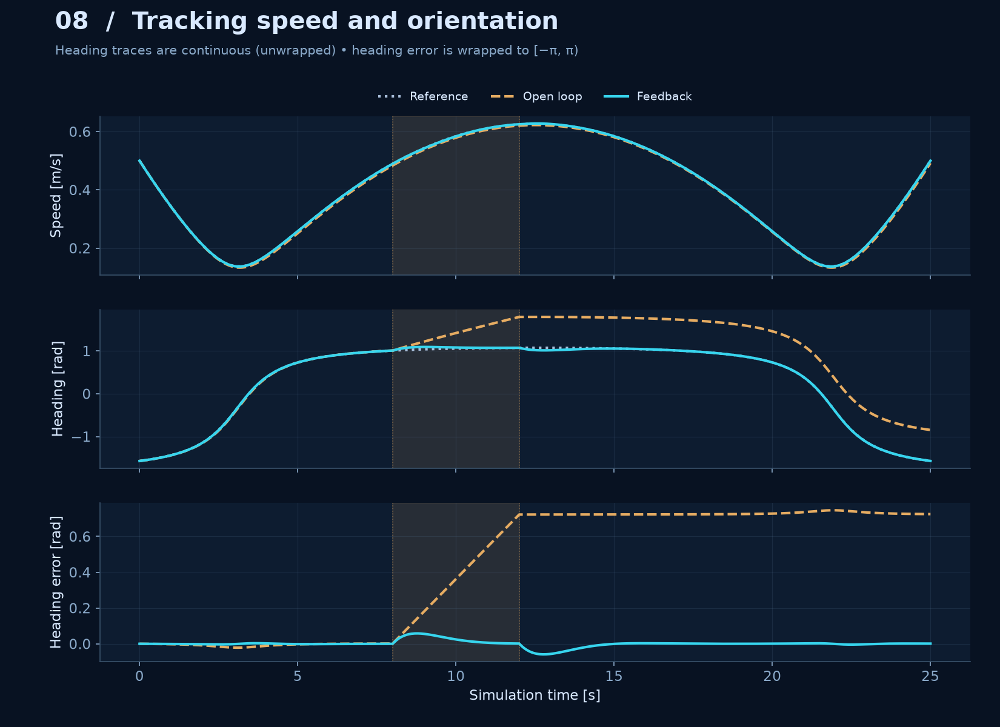

**08 · State tracking.** Heading is unwrapped for continuous display, while the heading error uses the shortest signed angle in [−π, π). The nonzero endpoint speed is visible.

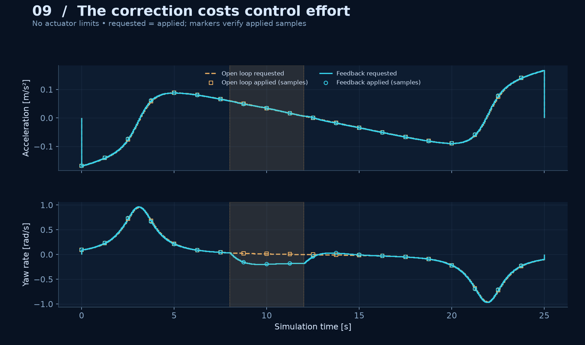

**09 · Control activity.** Requested and applied inputs coincide here. Markers independently show applied samples; the continuous yaw-bias correction primarily changes angular-rate effort. The disturbance is added downstream and is not part of the commanded yaw rate.

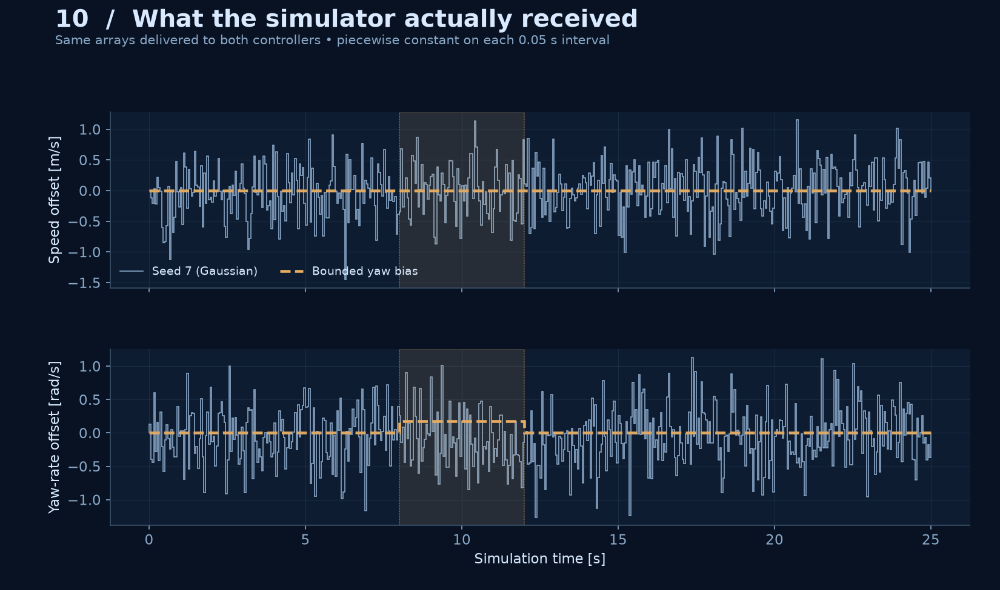

**10 · Disturbance profile.** Actual held samples from the logs, including the seed-7 Gaussian speed offset and yaw-rate offset. These are finite-duration sampled disturbances, not a timestep-independent stochastic differential equation.

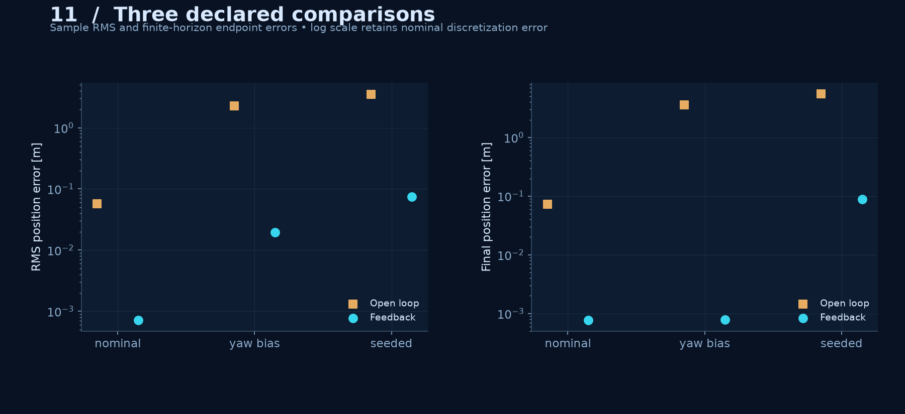

**11 · Scenario outcomes.** All three comparisons appear together. Logarithmic axes preserve the nominal errors rather than rounding them to zero. [SVG](media/11_scenario_outcomes.svg).

### Animation review frames

| Replay | Before | During | After |
| :-- | :-- | :-- | :-- |
| [Hero](media/hero.gif) | [Before](media/hero_before.png) | [During](media/hero_during.png) | [After](media/hero_after.png) |
| [Diagnostic replay](media/diagnostic_replay.gif) | [Before](media/diagnostic_replay_before.png) | [During](media/diagnostic_replay_during.png) | [After](media/diagnostic_replay_after.png) |

## Milestone 02: Obstacle-aware navigation

[Full milestone walkthrough](MILESTONE_02.md)

The same oriented rover, navy background, cyan feedback, amber open loop, pale reference, and equal spatial aspect ratios continue from Milestone 01. All empirical images and replay frames use saved data. Maps show supplied geometry, not perceived or learned surroundings.

### Planning: where can this rover fit?

**01 · Configuration space.** A 0.329 m disk encloses the original body and wheels at every heading. Conservative box inflation and inward boundary offsets give the point planner room for the rover and reserves. [SVG](media/navigation/01_configuration_space.svg).

**02 · A* versus Dijkstra.** Both use the same nodes, collision-checked edges, and Euclidean costs. The heuristic changes the search effort while preserving the optimal graph cost here. [SVG](media/navigation/02_astar_vs_dijkstra.svg).

**Search replay.** One shared expansion-count clock makes the algorithms' progress comparable. This is algorithmic work, not wall-clock speed. The path appears when each recorded search reaches its goal.

### Bridge the path to the motion model

**03 · Path to trajectory.** Grid edges and shortcut segments are checked continuously. Quadratic Bézier corners match line velocities at joins. Their full control-point boxes must stay free; unchecked smoothing is never assumed safe. [SVG](media/navigation/03_path_to_trajectory.svg).

**04 · Reference feasibility.** Analytical segment extrema constrain timing between samples as well as at them. Position and velocity are continuous; acceleration may jump at segment boundaries. This is a geometric planner plus a validated kinematic bridge, not a kinodynamic search or an energy optimum.

### Execute, measure, retain failures

**05 · Execution.** A safe reference does not protect a controller that drifts away from it. The first envelope overlap is marked, and the full unsafe open-loop history remains visible. Collision auditing is post hoc; neither controller replans or reacts to obstacles. [SVG](media/navigation/05_navigation_execution.svg).

**06 · Time progression.** Four snapshots use identical bounds and the same recorded comparison. Actual trails stop at the snapshot time; ghosts show desired poses.

**07 · Tracking error.** A common scale compares both controllers; a labelled centimetre-scale feedback panel exposes the smaller recovery. Shading marks the shared disturbance interval.

**08 · Clearance.** Tracking error and clearance answer different questions. The audit checks the enclosing disk against obstacles and boundaries and subtracts a bound on between-sample travel. Negative clearance is retained as a violation. [SVG](media/navigation/08_clearance_audit.svg).

**09 · Control activity.** Held applied commands, requested samples, and actuator limits are shown separately. Neither controller saturated in these declared runs; both were subject to the same limits.

### Understand the limits of the planner

**10 · Retained failures.** The sealed world has no route on either graph. In the 0.30 m passage a point path exists, but the conservative rover planner rejects it. No motion is executed for either rejected rover plan. This is not a universal impossibility proof for every physical configuration. [SVG](media/navigation/10_retained_planning_failures.svg).

**11 · Grid resolution.** Finer grids give different graphs and more search work. Costs at 0.5, 0.25, and 0.125 m spacing are 22.657, 22.364, and 22.218 m, with 168, 660, and 2,513 expansions.

### Animation review frames

| Replay | Before | During | After |
| :-- | :-- | :-- | :-- |
| [Navigation hero](media/navigation/navigation_hero.gif) | [Before](media/navigation/navigation_hero_before.png) | [During](media/navigation/navigation_hero_during.png) | [After](media/navigation/navigation_hero_after.png) |
| [Search replay](media/navigation/search_replay.gif) | [Before](media/navigation/search_replay_before.png) | [During](media/navigation/search_replay_during.png) | [After](media/navigation/search_replay_after.png) |

## Milestone 03: Sensing and localization

[Full milestone walkthrough](MILESTONE_03.md)

All empirical figures and replay frames use saved evidence. Navy, cyan, amber, the oriented rover, and equal spatial aspect ratios continue from the previous milestones.

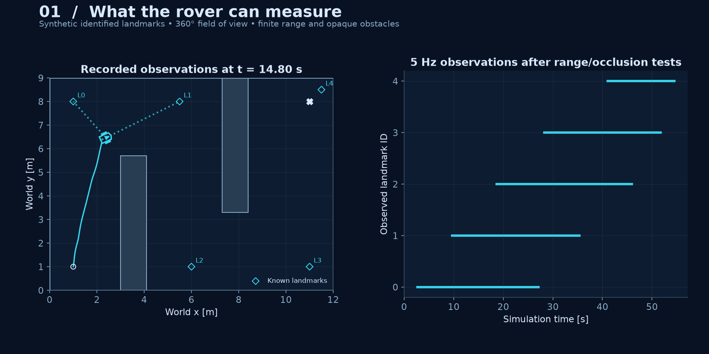

**01 · Sensing.** Which supplied landmarks can the rover actually observe? Range, occlusion, and the sensor schedule determine availability. [SVG](media/localization/01_sensing.svg).

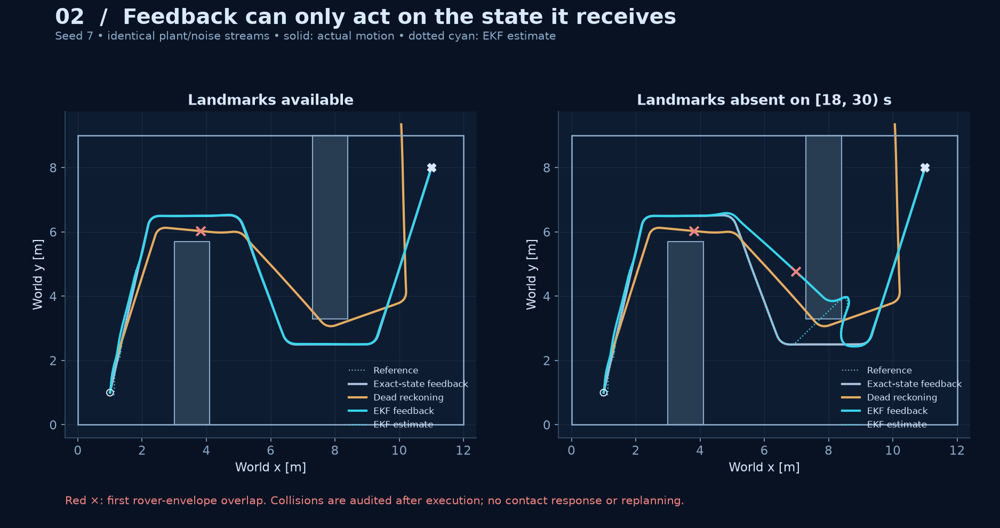

**02 · Estimated-state execution.** Landmarks correct drift in the left panel. During the outage, the estimated trajectory can look reasonable while the actual rover crosses an obstacle. Red crosses mark first envelope overlaps. [SVG](media/localization/02_execution.svg).

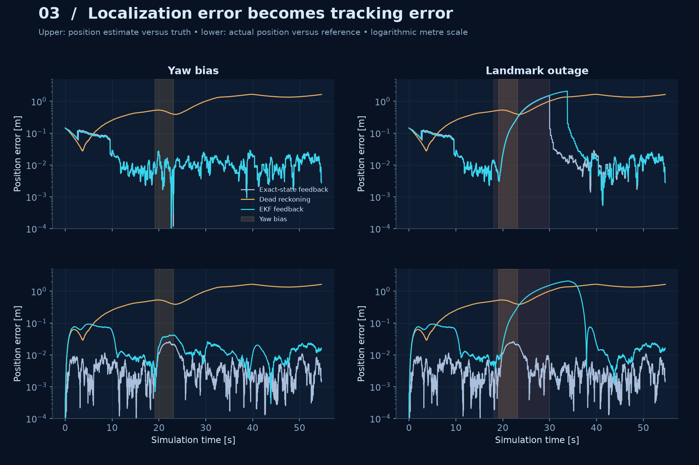

**03 · Two errors.** Estimation error compares estimate to truth; tracking error compares truth to the reference. Both are measured independently.

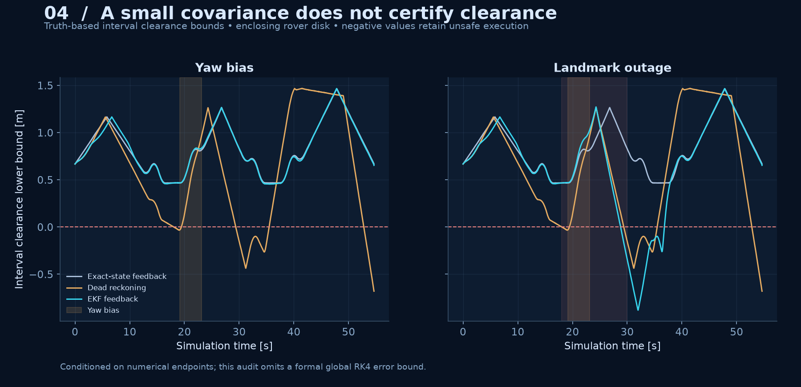

**04 · Clearance.** The existing disk-envelope audit evaluates actual motion. It does not stop, replan, or alter a controller. [SVG](media/localization/04_clearance.svg).

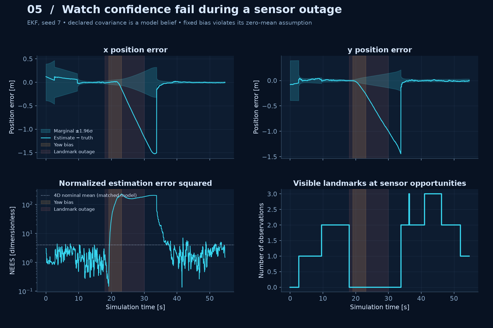

**05 · Confidence under model mismatch.** Position errors leave the declared marginal uncertainty bands during the outage. NEES and the recorded visibility history expose the mismatch; covariance is not presented as calibrated safety evidence.

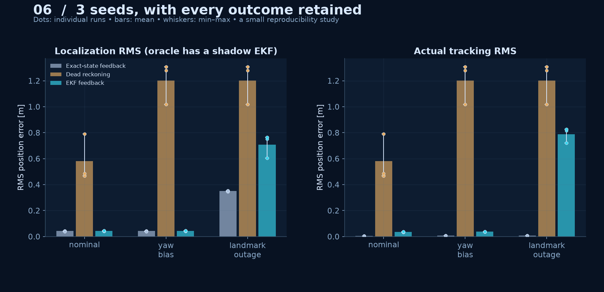

**06 · Reproducibility across seeds.** Individual runs remain visible beside means and min–max ranges. Three fixed seeds are a small study, not a probabilistic robustness guarantee.

### Animation review frames

| Replay | Before | During | After |
| :-- | :-- | :-- | :-- |
| [Localization hero](media/localization/localization_hero.gif) | [Before](media/localization/localization_hero_before.png) | [During](media/localization/localization_hero_during.png) | [After](media/localization/localization_hero_after.png) |

## Milestone 04: Landmark mapping and SLAM

[Full milestone walkthrough](MILESTONE_04.md)

All empirical figures and replay frames use saved evidence. Crosses show evaluation truth; they are not observations supplied to SLAM. Shaded obstacle geometry is supplied for routing.

**01 · Joint mapping.** Both filters begin without landmark coordinates. Reobservations constrain the joint map and motion belief. Ellipses show approximate 95% map marginals. [SVG](media/slam/01_mapping.svg).

**02 · Map growth.** Landmark means appear after their first sensor observation. Equal-scale snapshots retain discovery order and the actual trail.

**03 · Two errors.** Localization compares estimate with truth; tracking compares actual motion with the reference. Different closed-loop estimators produce different trajectories and visibility.

**04 · Revisit ablation.** These replays use identical recorded motion and observations. They isolate estimator behavior without claiming a counterfactual rover trajectory. [SVG](media/slam/04_revisits.svg).

**05 · Correlated belief.** The dense joint covariance retains relations between rover and map variables. A finite initial rover prior anchors the coordinate frame; covariance is a model belief, not a clearance certificate.

**06 · Retained failures.** Landmark corrections cannot undo earlier envelope overlaps. The full study also includes a partial run that exits the controller's speed domain. [SVG](media/slam/06_outage_clearance.svg).

### Animation review frames

| Replay | Before | During | After |
| :-- | :-- | :-- | :-- |
| [Slam hero](media/slam/slam_hero.gif) | [Before](media/slam/slam_hero_before.png) | [During](media/slam/slam_hero_during.png) | [After](media/slam/slam_hero_after.png) |

## Milestone 05: Decision-making and exploration

[Full milestone protocol](docs/exploration.md)

All empirical figures and replay frames use saved data. Amber is the baseline without health supervision; cyan is the supervised mission. The supplied obstacle map and candidate viewpoints remain explicit.

**01 · Online missions.** Tinted cells show estimated model coverage. Goal selection, recovery, and return produce a mission trajectory rather than following a fixed loop. [SVG](media/exploration/01_online_missions.svg).

**02 · State histories.** Temporary loss leads to recovery; persistent loss leads to abort. Short logs end at their actual terminal decision.

**03 · Goal utilities.** Selected goals follow the recorded candidate scores as model coverage and the landmark belief evolve. [SVG](media/exploration/03_goal_utilities.svg).

**04 · Clearance audit.** Unsafe baseline histories remain visible. A completed mission does not establish clear motion. [SVG](media/exploration/04_clearance.svg).

**05 · Health intervention.** The supervisor uses accepted-observation age and covariance. Actual speed is shown afterward for evaluation.

**06 · Completion audit.** A belief-based return can end metres from home. Aborted runs do not claim arrival; they remain included.

### Animation review frames

| Replay | Before | During | After |
| :-- | :-- | :-- | :-- |
| [Exploration hero](media/exploration/exploration_hero.gif) | [Before](media/exploration/exploration_hero_before.png) | [During](media/exploration/exploration_hero_during.png) | [After](media/exploration/exploration_hero_after.png) |
