# Milestone 02 · Obstacle-Aware Navigation

Archived milestone walkthrough and gallery. See the [current project status](README.md) for sensing and localization, which is now complete.

A wheeled-rover learning project accompanying *Principles of Robot Autonomy* by Gammelli, Lorenzetti, Luo, Zardini, and Pavone. We are building toward navigation, localization, mapping, exploration, and a return home—one reproducible milestone at a time.

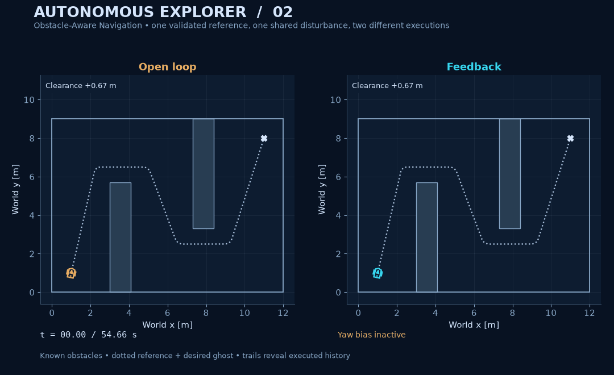

**Milestone 02 · Obstacle-Aware Navigation.** The rover plans around known obstacles, converts the geometric path into a collision-certified timed reference, and executes it with the extended-unicycle model and controller from [Milestone 01](MILESTONE_01.md). Both sides receive the same yaw disturbance. Cyan feedback stays clear in this experiment; amber open loop violates the collision envelope and eventually leaves the workspace. Those failures remain in the logs and animation.

This release adds finite-rover configuration-space geometry, deterministic A*, a Dijkstra baseline, validated path rounding and timing, clearance audits, six paired executions, two retained planning failures, eleven new figures, and two new GIFs. The map is supplied in advance. Sensors, state estimation, SLAM, online replanning, and parking remain future milestones.

## Reproduce it

Use [uv](https://docs.astral.sh/uv/) and the committed lockfile. `.python-version` selects Python 3.13; the package also supports Python 3.10+.

```bash
uv sync --frozen --extra dev
uv run --frozen explorer plan-reproduce --results build/navigation-reproduced/results --media build/navigation-reproduced/media
```

That one experiment command runs both searches, the resolution/failure studies, reference certification, all six executions, metrics, and the entire gallery. Results directories must be empty or new. Use a new output path for another reproduction.

Render from the committed logs, with no planner or simulator rerun:

```bash
uv run --frozen explorer plan-render --results results/navigation --media build/navigation-rendered
```

Run all tests and verify both milestones' evidence:

```bash
uv run --frozen pytest -q
uv run --frozen explorer plan-verify --results results/navigation
uv run --frozen explorer verify --results results/milestone
```

[`configs/navigation.json`](configs/navigation.json) controls map geometry, endpoints, rover envelope, margins, grid resolution, reference/control limits, sample time, gains, disturbances, seed, and playback. `--config path/to/config.json` selects another configuration; `plan-simulate` saves numerical results without rendering. The curated gallery follows `yaw_bias` and expects the three declared scenario names and two failure cases. Endpoints must lie on the grid; they are never silently snapped.

No new dependency was needed: NumPy, Matplotlib, and Pillow still suffice. Without uv, install with `python -m pip install -e '.[dev]'` in a virtual environment and use the same `explorer`/`pytest` commands. The original tracking-only commands and complete gallery remain in the [Milestone 01 archive](MILESTONE_01.md).

## Measured outcomes

A* and Dijkstra returned the same **22.364 m** optimal path cost on the 0.25 m graph. A* expanded **660 nodes**, Dijkstra **868**. Validated shortcuts reduce the path to six waypoints; corner rounding produces a **20.874 m** reference lasting **54.66 s**. These later paths are validated geometric constructions, with no continuous-path optimality claim.

The reference's continuous bounds are **0.3029–0.3876 m/s**, **0.1890 m/s²** maximum absolute acceleration, and **1.0000 rad/s** maximum absolute yaw rate. Both controllers share actuator limits of ±0.5 m/s² and ±1.2 rad/s. All six integrations completed without saturation or singular-speed exits. Completion alone is not a safety result:

<!-- navigation-outcomes:start -->
| Case | Controller | RMS error [m] | Final error [m] | Min disk clearance [m] | Envelope overlaps |
| :-- | :-- | --: | --: | --: | --: |
| nominal | open loop | 0.0274 | 0.0456 | 0.4695 | 0 |
| nominal | feedback | 0.0005 | 0.0000 | 0.4700 | 0 |
| yaw bias | open loop | 1.7382 | 3.0506 | -2.0091 | 553 |
| yaw bias | feedback | 0.0055 | 0.0000 | 0.4700 | 0 |
| seeded | open loop | 0.7614 | 1.4201 | 0.2135 | 0 |
| seeded | feedback | 0.0070 | 0.0097 | 0.4689 | 0 |
<!-- navigation-outcomes:end -->

The table comes from [`outcomes.md`](results/navigation/outcomes.md) and [`metrics.json`](results/navigation/metrics.json). The 0.0000 m entries are rounded; their stored values are about 3.1×10⁻⁹ m after a long final straight segment. The endpoint is still moving at 0.3876 m/s.

Yaw bias is +0.12 rad/s on **[19.14, 23.14) s**. Open loop first overlaps the conservative envelope at **28.76 s**. Feedback's smallest per-interval clearance audit bound is **0.4661 m** in that case; across all three feedback runs it is **0.4637 m**. Those bounds are conditioned on numerical integration endpoints and are not a formal safety guarantee under arbitrary disturbances. One seed is a demonstration, not a robustness study.

## Visual gallery

The same oriented rover, navy background, cyan feedback, amber open loop, pale reference, and equal spatial aspect ratios continue from Milestone 01. All empirical images and replay frames use saved data. Maps show supplied geometry, not perceived or learned surroundings.

### Planning: where can this rover fit?

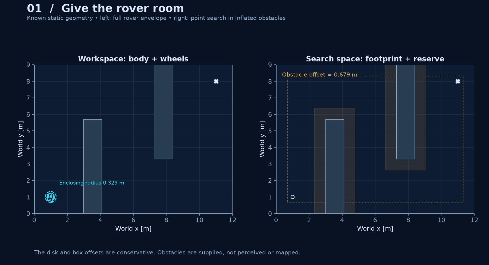

**01 · Configuration space.** A 0.329 m disk encloses the original body and wheels at every heading. Conservative box inflation and inward boundary offsets give the point planner room for the rover and reserves. [SVG](media/navigation/01_configuration_space.svg).

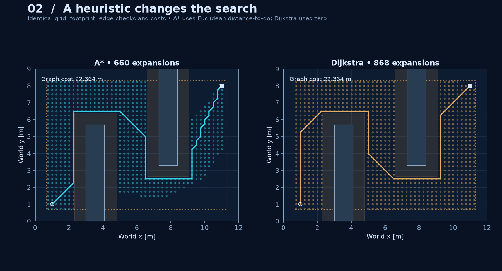

**02 · A* versus Dijkstra.** Both use the same nodes, collision-checked edges, and Euclidean costs. The heuristic changes the search effort while preserving the optimal graph cost here. [SVG](media/navigation/02_astar_vs_dijkstra.svg).

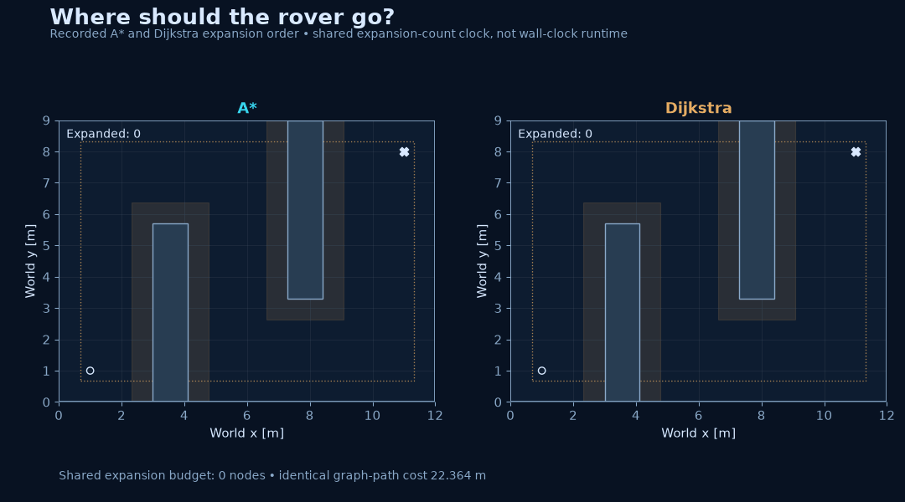

**Search replay.** One shared expansion-count clock makes the algorithms' progress comparable. This is algorithmic work, not wall-clock speed. The path appears when each recorded search reaches its goal.

### Bridge the path to the motion model

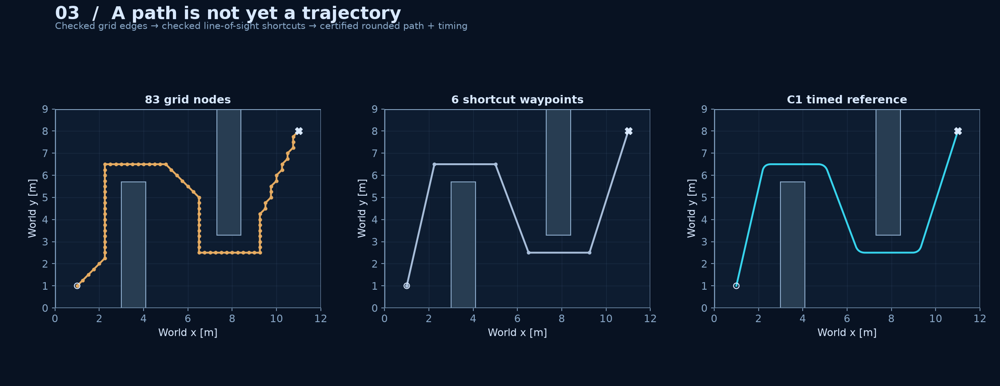

**03 · Path to trajectory.** Grid edges and shortcut segments are checked continuously. Quadratic Bézier corners match line velocities at joins. Their full control-point boxes must stay free; unchecked smoothing is never assumed safe. [SVG](media/navigation/03_path_to_trajectory.svg).

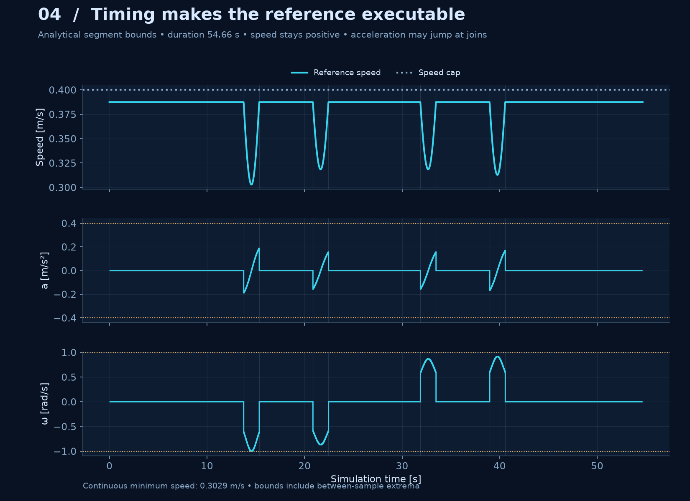

**04 · Reference feasibility.** Analytical segment extrema constrain timing between samples as well as at them. Position and velocity are continuous; acceleration may jump at segment boundaries. This is a geometric planner plus a validated kinematic bridge, not a kinodynamic search or an energy optimum.

### Execute, measure, retain failures

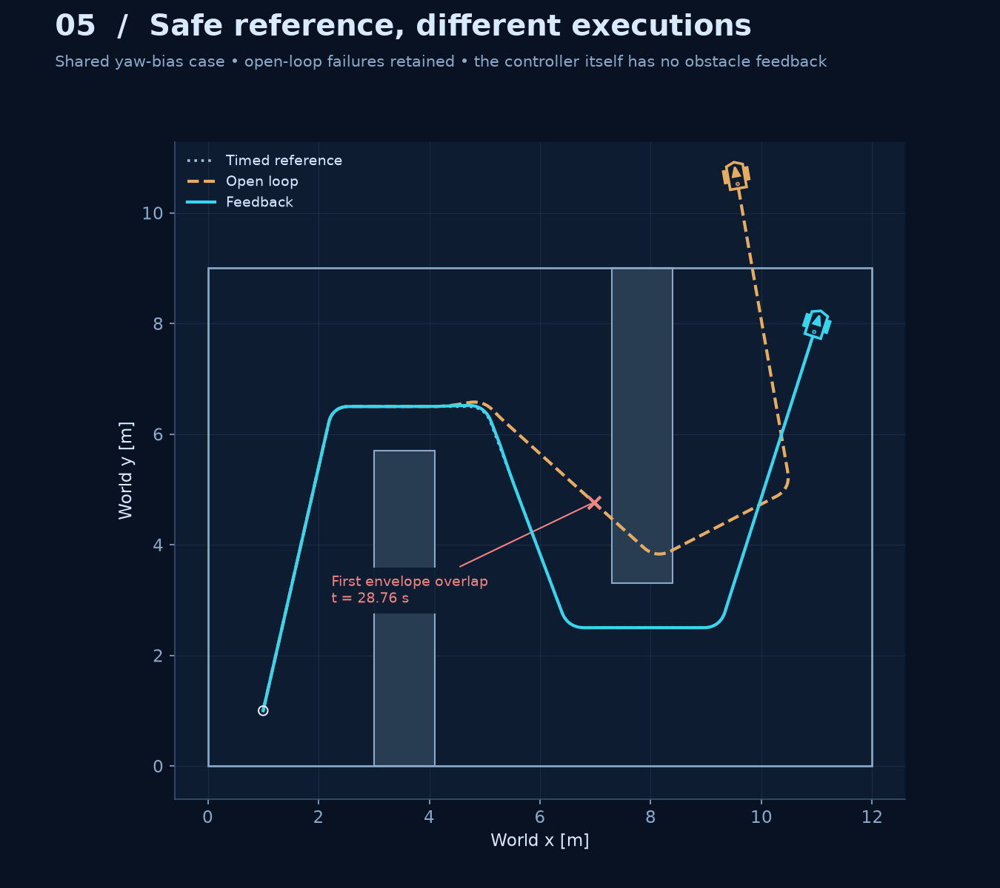

**05 · Execution.** A safe reference does not protect a controller that drifts away from it. The first envelope overlap is marked, and the full unsafe open-loop history remains visible. Collision auditing is post hoc; neither controller replans or reacts to obstacles. [SVG](media/navigation/05_navigation_execution.svg).

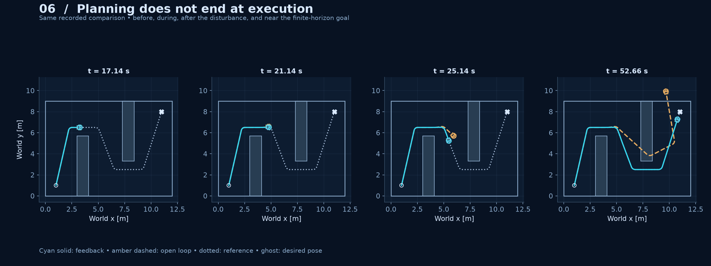

**06 · Time progression.** Four snapshots use identical bounds and the same recorded comparison. Actual trails stop at the snapshot time; ghosts show desired poses.

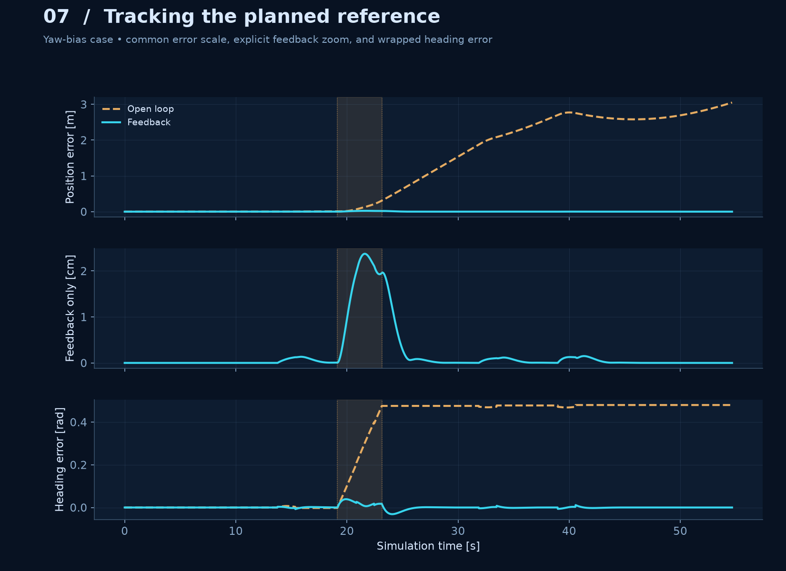

**07 · Tracking error.** A common scale compares both controllers; a labelled centimetre-scale feedback panel exposes the smaller recovery. Shading marks the shared disturbance interval.

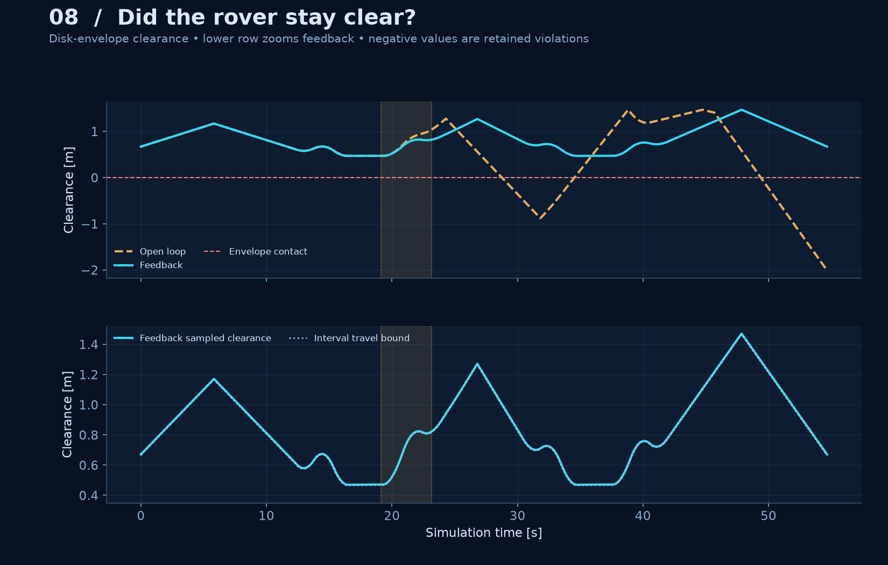

**08 · Clearance.** Tracking error and clearance answer different questions. The audit checks the enclosing disk against obstacles and boundaries and subtracts a bound on between-sample travel. Negative clearance is retained as a violation. [SVG](media/navigation/08_clearance_audit.svg).

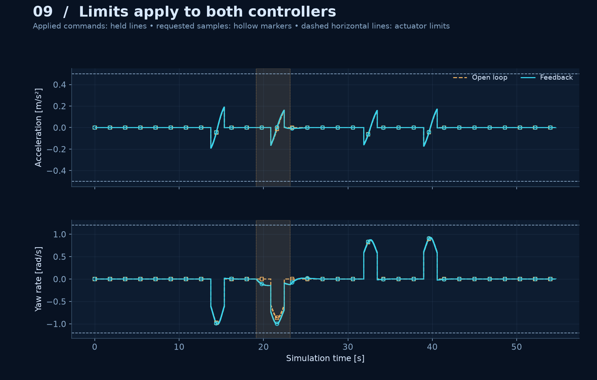

**09 · Control activity.** Held applied commands, requested samples, and actuator limits are shown separately. Neither controller saturated in these declared runs; both were subject to the same limits.

### Understand the limits of the planner

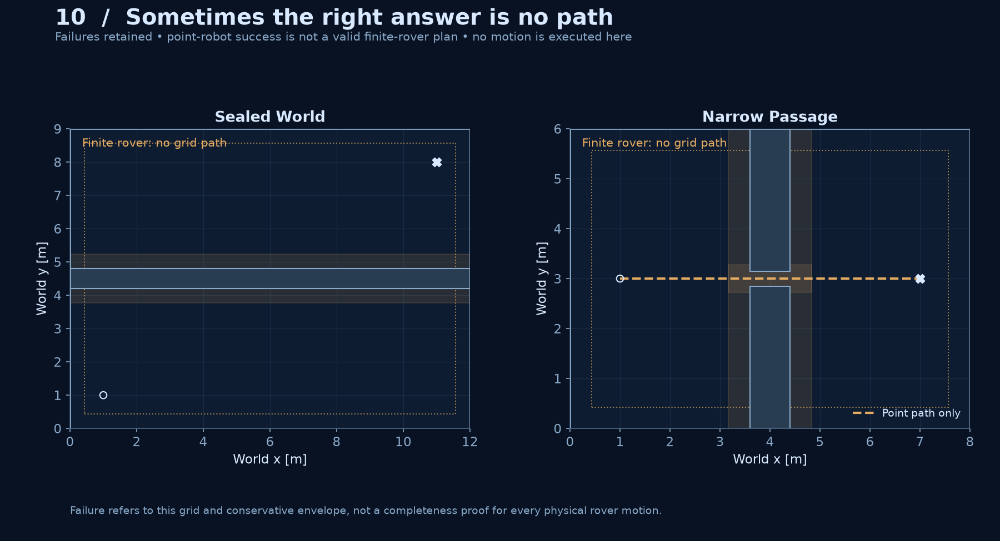

**10 · Retained failures.** The sealed world has no route on either graph. In the 0.30 m passage a point path exists, but the conservative rover planner rejects it. No motion is executed for either rejected rover plan. This is not a universal impossibility proof for every physical configuration. [SVG](media/navigation/10_retained_planning_failures.svg).

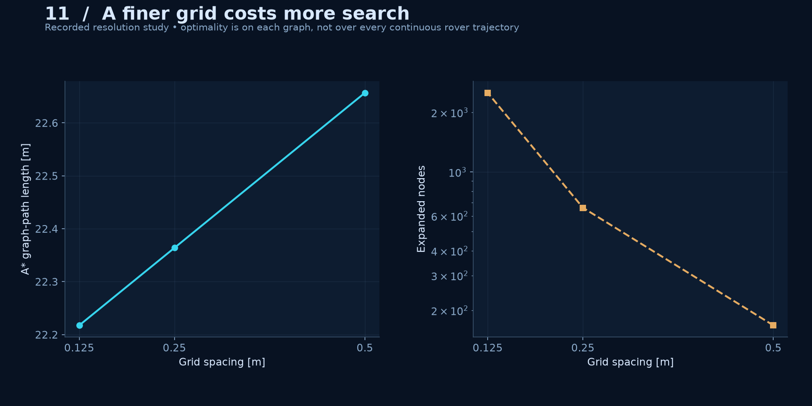

**11 · Grid resolution.** Finer grids give different graphs and more search work. Costs at 0.5, 0.25, and 0.125 m spacing are 22.657, 22.364, and 22.218 m, with 168, 660, and 2,513 expansions.

## Learn and inspect

Read the [navigation walkthrough and experiment protocol](docs/navigation.md), [source audit](docs/navigation-sources.md), and [verification record](docs/navigation-verification.md). The book anchor is [Chapter 4](https://porabook.com/book/motion-planning/), especially configuration space, grid search, and **Exercise 1: A* Motion Planning**. The original [Chapter 3 tracking foundations](MILESTONE_01.md) remain intact.

| Location | Responsibility |
| :-- | :-- |
| [`planning.py`](src/autonomous_explorer/planning.py) | Metric geometry, inflation, continuous edge tests, A*/Dijkstra, shortcuts |
| [`path_reference.py`](src/autonomous_explorer/path_reference.py) | Certified rounding, C1 joins, analytic control bounds and timing |
| [`navigation_evidence.py`](src/autonomous_explorer/navigation_evidence.py) | Protocol, failures, shared execution, clearance, metrics and evidence hashes |
| [`navigation_render.py`](src/autonomous_explorer/navigation_render.py) | Saved-data figures and animations using the shared rover/theme |
| [`results/navigation/`](results/navigation/) | Search histories, reference/certificates, six runs, clearance audits and metrics |
| [`tests/`](tests/) | Both milestones' numerical, geometric, replay and provenance checks |

## Next milestones

1. **Sensing and localization:** introduce explicit sensor models and an estimated state in place of exact simulator state; compare estimation error with tracking and clearance.
2. **Mapping and SLAM:** represent initially unknown surroundings, build a map, and estimate rover motion jointly.
3. **Decision-making and exploration:** choose goals, replan from new evidence, and return home.
4. **Goal regulation:** explicitly design a stop/park transition that handles the flatness controller's zero-speed singularity.

Current assumptions are a known static world, exact state, conservative collision geometry, and kinematic actuation. No online collision-avoidance guarantee, standstill recovery, sensing, uncertain localization, or hardware validation is claimed. The optional [CI template](docs/checks-workflow.yml) remains outside active GitHub workflows because the available token lacks `workflow` scope.

Original code and figures use the [MIT license](LICENSE). Study sources are attributed separately; no upstream exercise implementation or book PDF is vendored.
