# Autonomous Explorer

A wheeled-rover learning project accompanying *Principles of Robot Autonomy*. We are building toward navigation, localization, mapping, exploration, and a return home—one reproducible milestone at a time.

<!-- Keep the cumulative gallery link and visual history when advancing milestones. Append new milestones to GALLERY.md without removing earlier figures. -->
**[Complete visual gallery: all 40 figures and seven animations](GALLERY.md)**

[Tracking](GALLERY.md#milestone-01-trajectory-tracking) · [Navigation](GALLERY.md#milestone-02-obstacle-aware-navigation) · [Localization](GALLERY.md#milestone-03-sensing-and-localization) · [SLAM](GALLERY.md#milestone-04-landmark-mapping-and-slam) · [Exploration](GALLERY.md#milestone-05-decision-making-and-exploration)

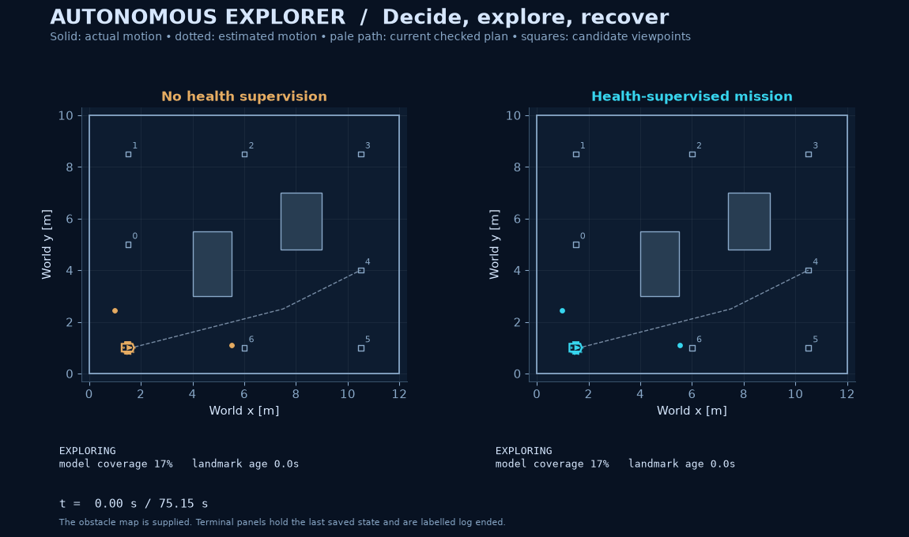

**Milestone 05 · Decision-Making and Viewpoint Exploration.** The rover now selects observation goals online, plans checked routes from its estimated position, builds its landmark map with SLAM, and decides when to return home. A localization-health supervisor brakes, waits for fresh observations, and replans after recovery. Persistent observation loss produces an explicit abort.

Across three seeds, supervised nominal and temporary-outage missions complete with positive clearance audits and meet the actual home-arrival tolerances. Persistent-outage missions stop exploring and abort. The unsupervised baseline exposes a failure: it reports completion during persistent observation loss while actually ending **2.1–4.0 m from home**, with envelope violations. Mission status, actual arrival, and actual clearance are audited separately.

## Project status

| Milestone | Status | Evidence |
| :-- | :-- | :-- |
| 01 · Trajectory tracking | Complete | [Walkthrough and gallery](MILESTONE_01.md) |
| 02 · Obstacle-aware navigation | Complete | [Walkthrough and gallery](MILESTONE_02.md) |
| 03 · Sensing and localization | Complete | [Walkthrough and gallery](MILESTONE_03.md) |
| 04 · Landmark mapping and SLAM | Complete | [Walkthrough and gallery](MILESTONE_04.md) |
| 05 · Decision-making and viewpoint exploration | Complete | [Protocol](docs/exploration.md), [18 missions](results/exploration/), [verification](docs/exploration-verification.md) |
| 06 · Unknown-space occupancy mapping and exploration | Next | Sense obstacle geometry, build free/occupied/unknown space, and select goals from that evolving map |
| Later · Precise goal regulation | Planned | Stationary parking with final-pose regulation and stronger stopping guarantees |

Exploration here means choosing among supplied **candidate observation viewpoints** using estimated coverage and map uncertainty. The obstacle map remains supplied. Point-landmark positions remain initially unknown to SLAM. There is no obstacle occupancy learning or frontier discovery in this milestone.

## Record of completed steps

This record connects every completed implementation stage to its visual evidence. The [complete gallery](GALLERY.md) displays all 40 figures, seven animations, 21 SVG exports, and 21 animation review frames. Earlier walkthroughs describe their original milestone; this README and [PLAN.md](PLAN.md) give the current status.

### 01 · Trajectory tracking foundations

Implemented the extended-unicycle model, Euler/RK4 integration, cubic references, flatness inversion, and exact-state PD feedback. Six executions compare nominal, yaw-bias, and seeded disturbances using shared inputs. Under yaw bias, feedback RMS position error is **0.0195 m**, versus **2.2768 m** open loop. The reference ends moving; the retained zero-speed probe exposes the controller's singularity.

| Completed step | Visual evidence |
| :-- | :-- |
| Define rover state, geometry, body/world frames, and control units | [01 · Robot geometry](media/01_robot_geometry.png) |
| Integrate straight, turning, circular, and composed commands | [02 · Motion primitives](media/02_motion_primitives.png) |
| Check Euler and RK4 against analytical motion | [03 · Integration accuracy](media/03_integration_accuracy.png) |
| Construct the cubic reference from endpoint positions and velocities | [04 · Reference construction](media/04_reference_construction.png) |
| Compare open-loop commands and feedback under the same disturbance | [05 · Trajectories](media/05_trajectory_comparison.png), [motion replay](media/hero.gif) |
| Follow one saved run before, during, and after the disturbance | [06 · Temporal progression](media/06_temporal_progression.png), [diagnostic replay](media/diagnostic_replay.gif) |
| Measure position error independently from the displayed path | [07 · Position error](media/07_position_error.png) |
| Inspect speed, heading, and wrapped heading error | [08 · State tracking](media/08_state_tracking.png) |
| Log requested and applied acceleration/yaw commands | [09 · Control activity](media/09_control_activity.png) |
| Save and display the actual held disturbance samples | [10 · Disturbance profile](media/10_disturbance_profile.png) |
| Compare all declared scenarios and retain failure evidence | [11 · Scenario outcomes](media/11_scenario_outcomes.png), [zero-speed probe](results/milestone/zero_speed_probe.json) |

[Walkthrough and code map](MILESTONE_01.md) · [Protocol and equations](docs/walkthrough.md) · [Source audit and exercise deviations](docs/sources.md) · [Configuration](configs/milestone.json) · [Results](results/milestone/outcomes.md) · [Verification](docs/verification.md) · [Media provenance](media/provenance.json)

### 02 · Obstacle-aware navigation

Added finite-rover collision geometry, deterministic A*/Dijkstra search, checked shortcuts, rounded timed references, and actual-motion clearance audits. Both searches find **22.364 m** graph cost; A* expands **660** nodes versus **868**. All three feedback executions pass the numerical interval-clearance audit. The yaw-disturbed open-loop execution retains **553** envelope-overlap samples. Planning uses a supplied map; clearance is evaluated afterward.

| Completed step | Visual evidence |
| :-- | :-- |
| Enclose the rover and inflate obstacles/boundaries with stated reserves | [01 · Configuration space](media/navigation/01_configuration_space.png) |
| Compare A* and Dijkstra on the same collision-checked graph | [02 · Search comparison](media/navigation/02_astar_vs_dijkstra.png), [search replay](media/navigation/search_replay.gif) |
| Convert checked grid paths and shortcuts into rounded references | [03 · Path to trajectory](media/navigation/03_path_to_trajectory.png) |
| Certify continuous segment speed, acceleration, yaw, and geometry bounds | [04 · Reference feasibility](media/navigation/04_reference_feasibility.png) |
| Execute shared-disturbance open-loop and feedback comparisons | [05 · Navigation execution](media/navigation/05_navigation_execution.png), [motion replay](media/navigation/navigation_hero.gif) |
| Compare synchronized saved-state snapshots at fixed spatial scale | [06 · Navigation snapshots](media/navigation/06_navigation_snapshots.png) |
| Measure tracking error, including the smaller feedback recovery | [07 · Navigation error](media/navigation/07_navigation_error.png) |
| Audit actual disk clearance and between-sample travel | [08 · Clearance audit](media/navigation/08_clearance_audit.png) |
| Inspect requested/applied controls and shared actuator limits | [09 · Navigation controls](media/navigation/09_navigation_controls.png) |
| Retain sealed-world and narrow-passage planning rejections | [10 · Planning failures](media/navigation/10_retained_planning_failures.png) |
| Measure graph cost and search work at three grid resolutions | [11 · Grid resolution](media/navigation/11_grid_resolution.png) |

[Walkthrough and code map](MILESTONE_02.md) · [Protocol and equations](docs/navigation.md) · [Source audit and smoothing deviation](docs/navigation-sources.md) · [Configuration](configs/navigation.json) · [Results](results/navigation/outcomes.md) · [Verification](docs/navigation-verification.md) · [Media provenance](media/navigation/provenance.json)

### 03 · Sensing and localization

Added scheduled speed and identified range/bearing sensors, visibility/occlusion, and an EKF whose estimated state drives feedback. **27 executions** compare oracle, dead reckoning, and EKF across three seeds and three conditions. Nominal EKF mean localization RMS is **0.0432 m**. All three outage EKF runs violate the clearance envelope; these failures motivate later health supervision.

| Completed step | Visual evidence |
| :-- | :-- |
| Model sensor geometry, range, occlusion, noise, and measurement timing | [01 · Sensing](media/localization/01_sensing.png) |
| Drive feedback from exact, dead-reckoned, or EKF state with shared noise streams | [02 · Execution](media/localization/02_execution.png), [motion replay](media/localization/localization_hero.gif) |
| Measure localization and actual tracking errors separately | [03 · Errors](media/localization/03_errors.png) |
| Audit actual clearance independently of estimator confidence | [04 · Clearance](media/localization/04_clearance.png) |
| Inspect covariance and normalized estimation error during model mismatch | [05 · Uncertainty](media/localization/05_uncertainty.png) |
| Compare individual seeds, means, ranges, and retained failures | [06 · Seed comparison](media/localization/06_seed_comparison.png) |

[Walkthrough and code map](MILESTONE_03.md) · [Protocol and equations](docs/localization.md) · [Source notes](docs/localization-sources.md) · [Configuration](configs/localization.json) · [Results](results/localization/summary.md) · [Verification](docs/localization-verification.md) · [Media provenance](media/localization/provenance.json)

### 04 · Landmark mapping and SLAM

Added inverse-observation landmark initialization, joint rover/map covariance, reobservation corrections, and estimated-state feedback. **18 executions plus six matched estimator replays** compare supplied-map estimation, first-sighting mapping, and SLAM. Nominal SLAM discovers all six landmarks with **0.1489 m** mean pose RMS and **0.1289 m** final map RMS. Outage collisions and a partial low-speed exit remain recorded. This learns point landmarks while obstacle geometry stays supplied.

| Completed step | Visual evidence |
| :-- | :-- |
| Initialize unknown landmark coordinates and compare mapping estimators | [01 · Mapping](media/slam/01_mapping.png), [motion/map replay](media/slam/slam_hero.gif) |
| Record first discovery and later correction of each feature | [02 · Map growth](media/slam/02_map_growth.png) |
| Separate pose-estimation error from actual tracking error | [03 · Errors](media/slam/03_errors.png) |
| Replay identical motion/observations with revisits accepted or denied | [04 · Revisit ablation](media/slam/04_revisits.png) |
| Inspect rover/landmark correlations and joint uncertainty | [05 · Joint uncertainty](media/slam/05_joint_uncertainty.png) |
| Retain unsafe outage histories and the incomplete controller-domain exit | [06 · Outage clearance](media/slam/06_outage_clearance.png), [per-run outcomes](results/slam/outcomes.md) |

[Walkthrough and code map](MILESTONE_04.md) · [Protocol and equations](docs/slam.md) · [Source notes](docs/slam-sources.md) · [Configuration](configs/slam.json) · [Results](results/slam/summary.md) · [Verification](docs/slam-verification.md) · [Media provenance](media/slam/provenance.json)

### 05 · Decision-making and viewpoint exploration

Added belief-based viewpoint utility, checked online routes, zero-speed waypoint control, localization-health supervision, recovery replanning, return home, and explicit aborts. **18 missions** compare supervised and unsupervised policies across three seeds and three observation conditions. Supervised nominal and temporary-outage missions all pass the actual-home and clearance audits. Persistent-loss baselines report completion metres from home; supervised missions abort. [Detailed outcomes](#measured-outcomes) and the six figures below retain both results.

| Completed step | Visual evidence |
| :-- | :-- |
| Select observation goals, route from estimated poses, build the landmark map, and return home | [01 · Online missions](media/exploration/01_online_missions.png), [mission replay](media/exploration/exploration_hero.gif) |
| Brake, wait, recover/replan, or abort from localization-health evidence | [02 · Supervisor states](media/exploration/02_supervisor_states.png) |
| Record candidate scores from coverage, map uncertainty, and route length | [03 · Goal utilities](media/exploration/03_goal_utilities.png) |
| Audit actual clearance independently of mission status | [04 · Clearance](media/exploration/04_clearance.png) |
| Relate observation age and covariance intervention to actual speed | [05 · Localization health](media/exploration/05_localization_health.png) |
| Distinguish reported completion, model coverage, and actual home arrival | [06 · Completion audit](media/exploration/06_completion_audit.png) |

[Protocol, equations, and transition rules](docs/exploration.md) · [Source notes and heuristic limits](docs/exploration-sources.md) · [Configuration](configs/exploration.json) · [Results](results/exploration/summary.md) · [Verification](docs/exploration-verification.md) · [Media provenance](media/exploration/provenance.json)

## Reproduce it

Use [uv](https://docs.astral.sh/uv/) and the committed lockfile:

```bash
uv sync --frozen --extra dev
uv run --frozen explorer explore-reproduce --results build/exploration-reproduced/results --media build/exploration-reproduced/media
```

This runs three seeds × three observation conditions × two supervisor modes, then renders six figures and one GIF. Numerical result directories must be empty or new.

```bash
uv run --frozen explorer explore-verify --results results/exploration
uv run --frozen pytest -q
uv run --frozen ruff check src tests
uv run --frozen ruff format --check src tests
```

Verification reconstructs SLAM, goal utilities, plans, supervisor transitions, and requested controls from saved observations and applied commands. It separately recalculates metrics and physical clearance from actual saved states. Rendering uses the same saved evidence:

```bash
uv run --frozen explorer explore-render --results results/exploration --media build/exploration-rendered
```

`explore-simulate` saves numerical evidence without the gallery. [configs/exploration.json](configs/exploration.json) controls candidates, utility weights, motion limits, health thresholds, outages, and seeds. Its SLAM configuration resolves relative to that file; the complete configuration is embedded in the evidence. The curated gallery expects `nominal`, `temporary_outage`, and `persistent_outage` cases. Runtime dependencies remain NumPy, Matplotlib, and Pillow.

Earlier commands and evidence remain available:

```bash
uv run --frozen explorer verify --results results/milestone
uv run --frozen explorer plan-verify --results results/navigation
uv run --frozen explorer localize-verify --results results/localization
uv run --frozen explorer slam-verify --results results/slam
```

Every milestone retains a complete run-and-render command and a saved-data-only rendering command:

| Milestone | Run and render command | Render saved evidence | Saved results / curated media |
| :-- | :-- | :-- | :-- |
| 01 | `reproduce` | `render` | `results/milestone` / `media` |
| 02 | `plan-reproduce` | `plan-render` | `results/navigation` / `media/navigation` |
| 03 | `localize-reproduce` | `localize-render` | `results/localization` / `media/localization` |
| 04 | `slam-reproduce` | `slam-render` | `results/slam` / `media/slam` |
| 05 | `explore-reproduce` | `explore-render` | `results/exploration` / `media/exploration` |

Use `uv run --frozen explorer COMMAND --results NEW_RESULTS --media NEW_MEDIA` for a full reproduction, choosing new result directories each time. For rendering alone, select the saved results directory from the table and a new media directory. All commands and configuration details are expanded in the milestone walkthroughs above. Earlier clean reproductions are documented in their verification records; the current delivery audit rechecks saved evidence without claiming a fresh simulation campaign.

## Documentation and delivery audit

Audited on **2026-10-26**. The [audit record](docs/progress-audit.md) distinguishes checks performed now from previously reported experiment reproductions. It also records branch publication, ignored development outputs, and the optional CI limitation.

```bash
python scripts/audit_progress.py
```

This checks local documentation links and section anchors, Git tracking, every saved-result checksum, gallery provenance, and complete README/gallery coverage for the five registered milestones. The README links every primary figure and animation directly; the gallery additionally links every SVG and review frame. It fails if an asset is missing, altered, untracked, or omitted. Run the five `explorer …verify` commands above for numerical/estimator/mission replay; the documentation audit does not replace them.

GitHub's **About description and all nine capability topics were updated and read back successfully** on 2026-10-26. The optional [CI template](docs/checks-workflow.yml) remains documented rather than active; no GitHub Actions success is claimed. The [delivery instructions](AGENTS.md) require preserving earlier evidence, updating this record, and verifying every progress push. Milestone 06 remains the exact next implementation step.

## What changed

- **Goal selection:** a deterministic utility combines unseen modelled observation cells, estimated landmark uncertainty, and checked route length. Every candidate score and selected goal is recorded. This is a greedy heuristic without a global optimality claim.
- **Online planning:** the planner connects the continuous pose estimate to a lattice through a checked segment, uses A* where needed, and validates all shortcut segments. Goals are replanned after recovery or a large pose correction.
- **Mission supervision:** `exploring → returning → complete`, with `braking → waiting → resume/abort` when landmark information is stale or position uncertainty grows. Fresh observations and recovery hysteresis govern resumption; the policy cannot read the outage schedule.
- **Zero-speed control:** a heading/speed waypoint controller permits braking, waiting, and turning at rest. The earlier flatness controller and all of its evidence remain intact. Low-speed arrival is distinct from precise parked-pose regulation.

## Measured outcomes

“Reports complete” is the mission's decision from estimated state. “Home audit” additionally requires actual final distance ≤0.30 m and actual absolute speed ≤0.05 m/s. “Clear audit” requires positive numerical interval clearance over the entire recorded history and can also hold for an aborted mission. Coverage is a modelled visibility footprint from estimated sensor poses, not measured unknown-space occupancy.

<!-- exploration-summary:start -->
| Case | Supervisor | Reports complete | Home audit | Aborted | Clear audit | Mean model coverage |
| :-- | :-- | --: | --: | --: | --: | --: |
| nominal | unguarded | 3/3 | 3/3 | 0/3 | 3/3 | 99.1% |
| nominal | guarded | 3/3 | 3/3 | 0/3 | 3/3 | 99.1% |
| temporary outage | unguarded | 0/3 | 0/3 | 3/3 | 2/3 | 77.3% |
| temporary outage | guarded | 3/3 | 3/3 | 0/3 | 3/3 | 99.1% |
| persistent outage | unguarded | 3/3 | 0/3 | 0/3 | 0/3 | 44.5% |
| persistent outage | guarded | 0/3 | 0/3 | 3/3 | 3/3 | 44.5% |
<!-- exploration-summary:end -->

The table is generated from [summary.md](results/exploration/summary.md); [metrics.json](results/exploration/metrics.json) retains each run. The temporary outage suppresses landmarks on **[14,22) s**. The persistent outage suppresses them from **14 s** onward. Both disturbed conditions add +0.12 rad/s yaw bias on **[14,18) s**, and all conditions have shared pre-generated plant and sensor noise.

Supervised nominal and temporary-outage completions end **0.114–0.167 m from actual home**, at actual absolute stored speeds **0.024–0.042 m/s**. Persistent-loss aborts occur at **29.85 s**, with actual absolute stored speeds below **0.004 m/s**. These are observed outcomes of three seeds, not a formal stopping or collision-avoidance guarantee. The model's translational disturbance can still move a rover whose stored speed is zero.

## Visual gallery

All empirical figures and replay frames use saved data. Amber is the baseline without health supervision; cyan is the supervised mission. The supplied obstacle map and candidate viewpoints remain explicit.

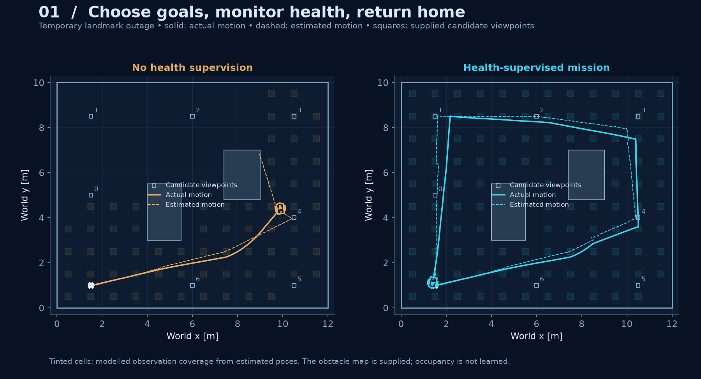

**01 · Online missions.** Tinted cells show estimated model coverage. Goal selection, recovery, and return produce a mission trajectory rather than following a fixed loop. [SVG](media/exploration/01_online_missions.svg).

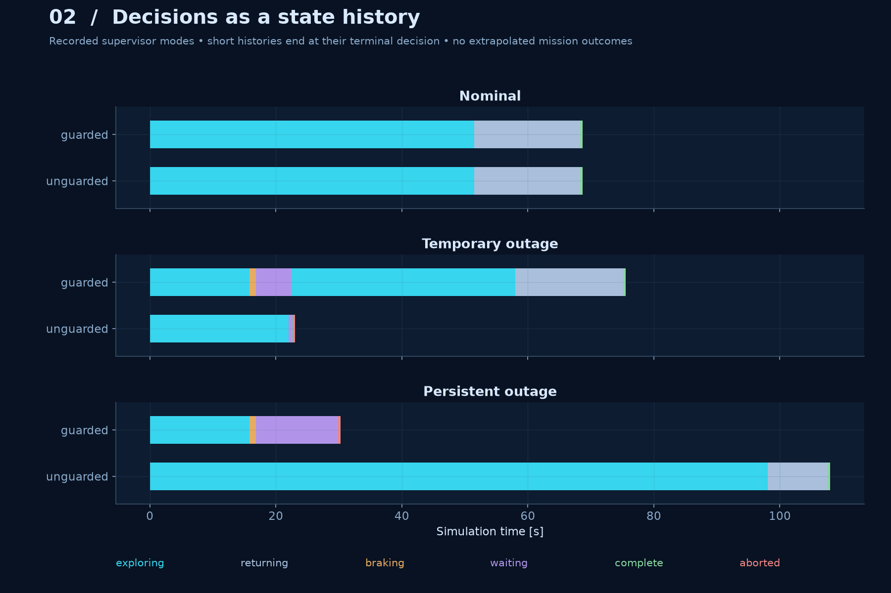

**02 · State histories.** Temporary loss leads to recovery; persistent loss leads to abort. Short logs end at their actual terminal decision.

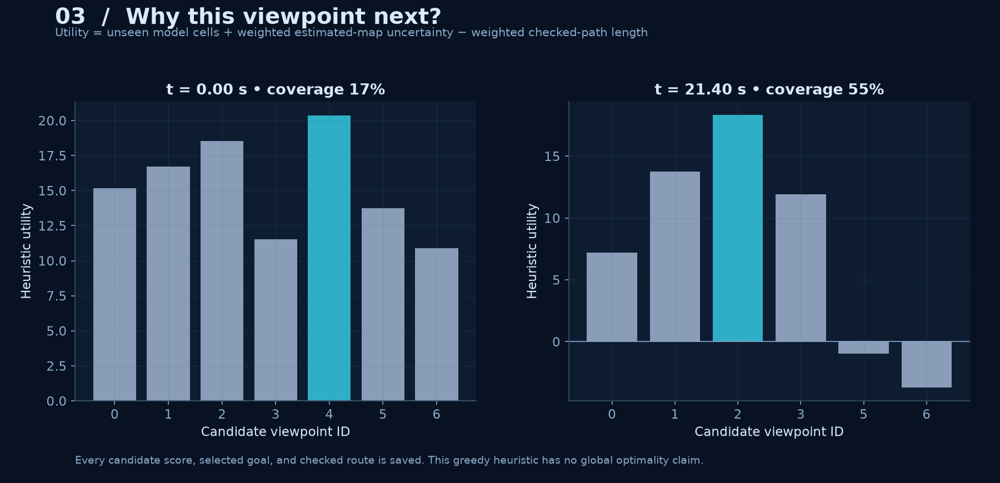

**03 · Goal utilities.** Selected goals follow the recorded candidate scores as model coverage and the landmark belief evolve. [SVG](media/exploration/03_goal_utilities.svg).

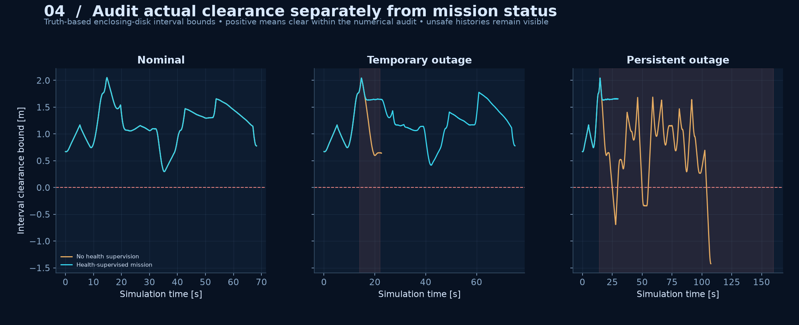

**04 · Clearance audit.** Unsafe baseline histories remain visible. A completed mission does not establish clear motion. [SVG](media/exploration/04_clearance.svg).

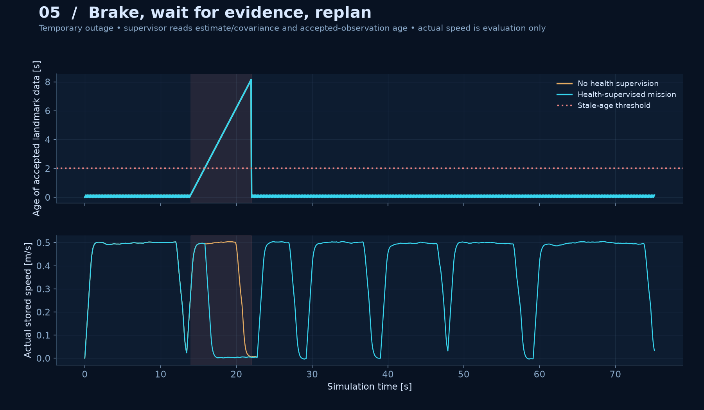

**05 · Health intervention.** The supervisor uses accepted-observation age and covariance. Actual speed is shown afterward for evaluation.

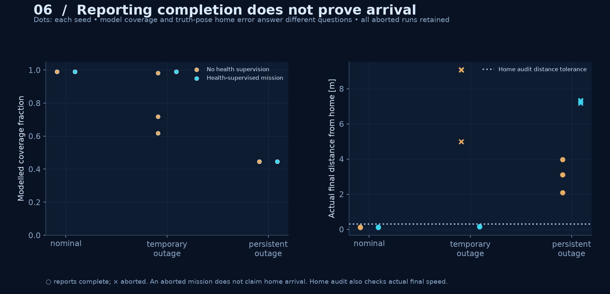

**06 · Completion audit.** A belief-based return can end metres from home. Aborted runs do not claim arrival; they remain included.

## Visual history

Earlier milestones remain part of the project gallery. The [complete visual gallery](GALLERY.md) displays every figure and animation with its original explanation, SVG links, and animation review frames.

### Milestone 01: Trajectory tracking

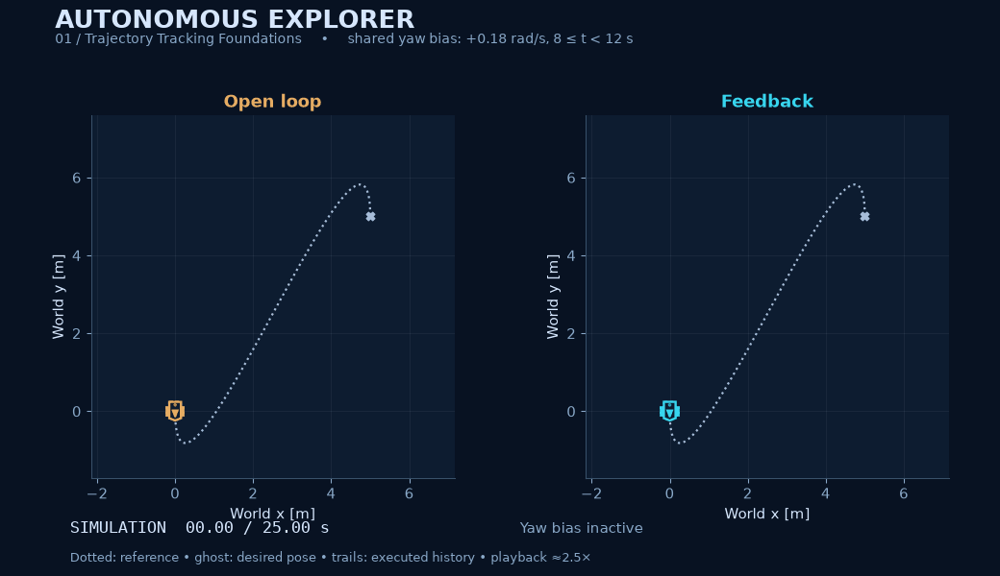

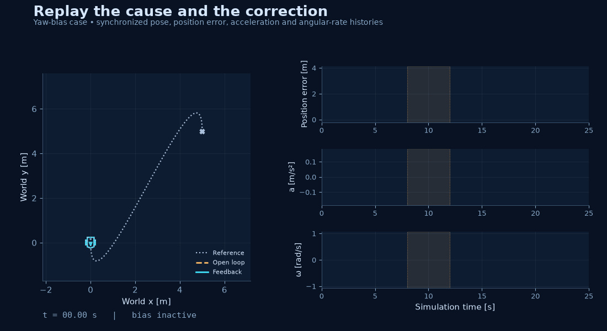

[All 11 tracking figures and both animations](GALLERY.md#milestone-01-trajectory-tracking) · [Full walkthrough](MILESTONE_01.md)

### Milestone 02: Obstacle-aware navigation


[All 11 navigation figures and both animations](GALLERY.md#milestone-02-obstacle-aware-navigation) · [Full walkthrough](MILESTONE_02.md)

### Milestone 03: Sensing and localization

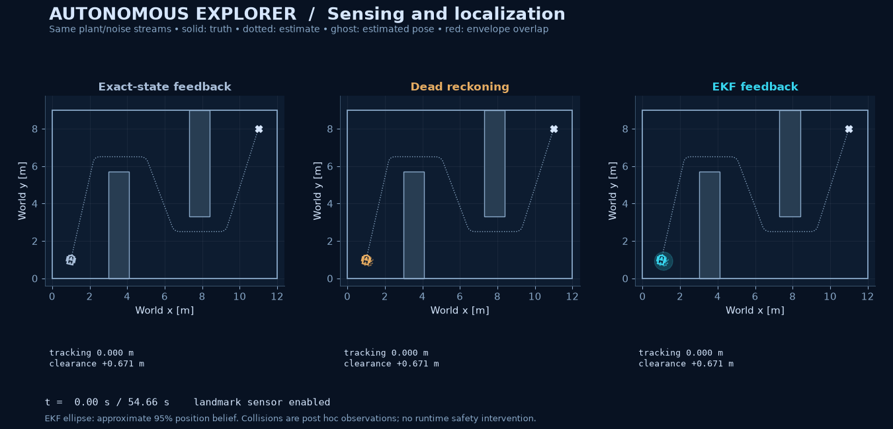

[All six localization figures and the animation](GALLERY.md#milestone-03-sensing-and-localization) · [Full walkthrough](MILESTONE_03.md)

### Milestone 04: Landmark mapping and SLAM

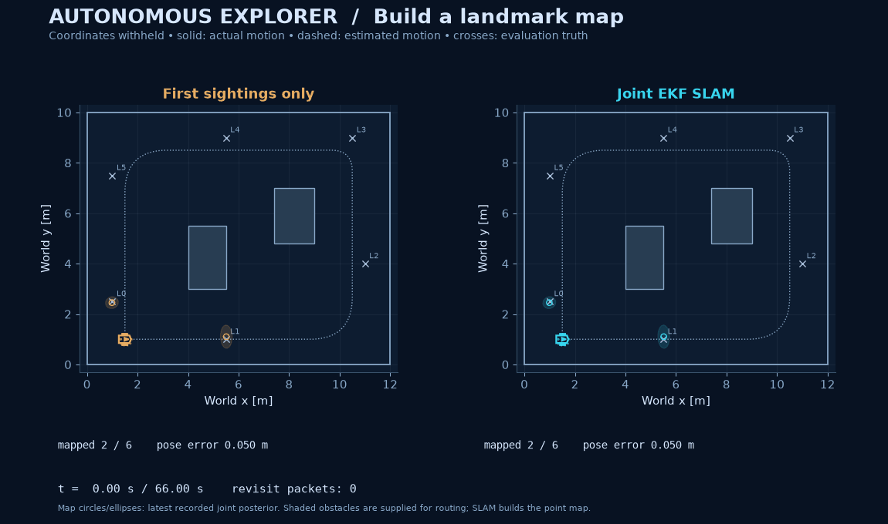

[All six SLAM figures and the animation](GALLERY.md#milestone-04-landmark-mapping-and-slam) · [Full walkthrough](MILESTONE_04.md)

## Learn and inspect

Read the [mission protocol and transition rules](docs/exploration.md), [source notes](docs/exploration-sources.md), and [verification record](docs/exploration-verification.md). The book anchor is [Chapter 16 · Finite State Machines](https://porabook.com/book/finite-state-machines/).

| Location | Responsibility |
| :-- | :-- |
| [mission.py](src/autonomous_explorer/mission.py) | Belief-only utilities, checked plans, waypoint commands, supervisor and return logic |
| [exploration_evidence.py](src/autonomous_explorer/exploration_evidence.py) | Synthetic sensor/SLAM integration, mission replay, actual-state audits and checksums |
| [exploration_render.py](src/autonomous_explorer/exploration_render.py) | Saved-data mission gallery and animation |
| [tests/test_exploration.py](tests/test_exploration.py) | Goal changes, route checks, state transitions, zero speed, truth-free replay and honest completion |

Assumptions remain a supplied static obstacle map, known feature IDs, synchronous synthetic sensors, a local initial-pose prior, and kinematic actuation. Estimated coverage is a proxy. The health rules are heuristics, and the clearance audit remains conditioned on numerical integration endpoints without a formal global RK4 error enclosure. There is no hardware validation or exact stationary parking claim.

The next milestone is **unknown-space occupancy mapping and exploration**. The [optional CI template](docs/checks-workflow.yml) includes all five milestones. Original code and figures use the [MIT license](LICENSE); study sources are attributed separately.
