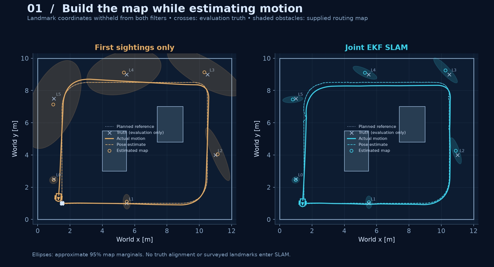
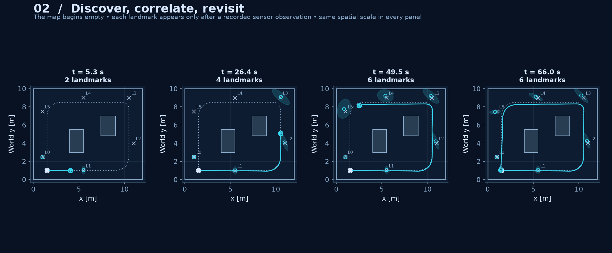
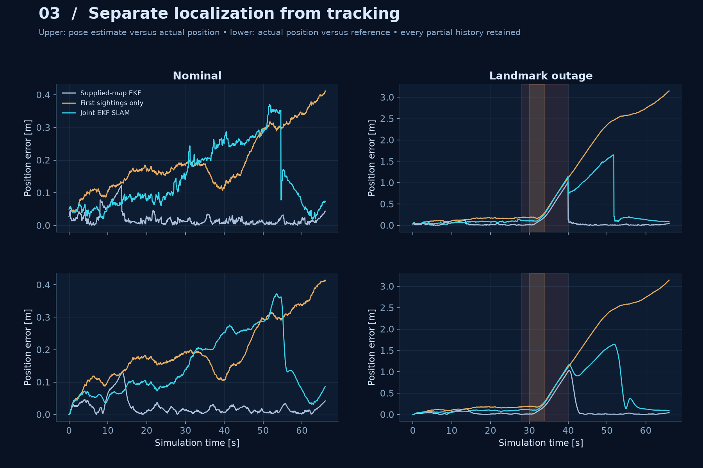
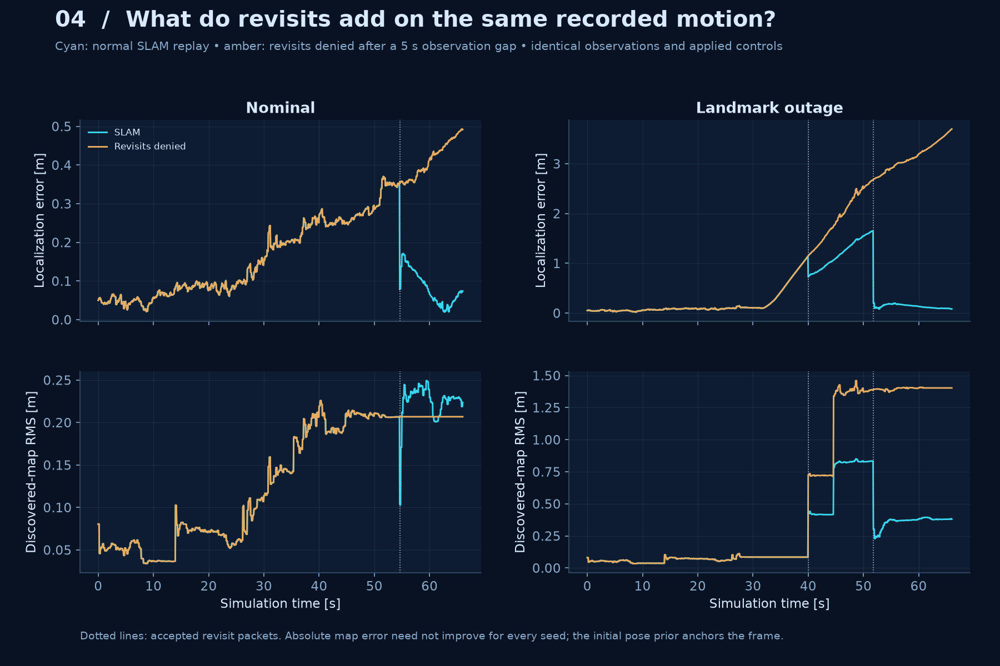
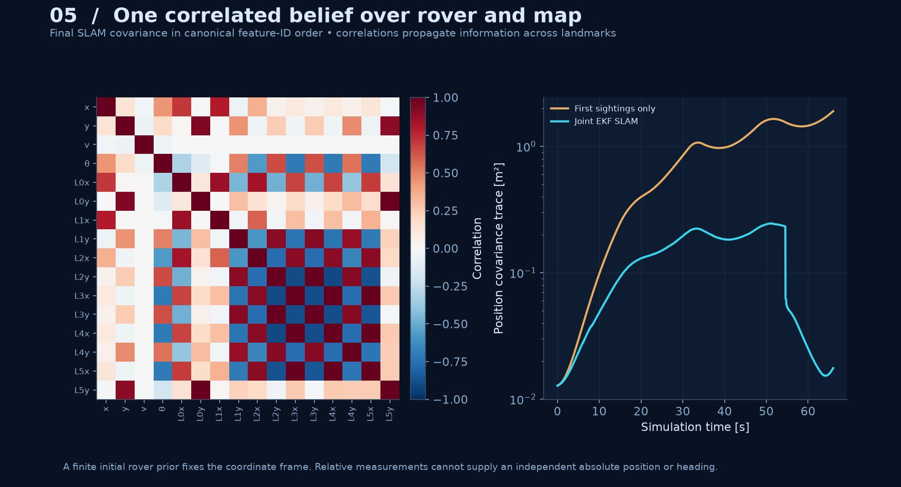
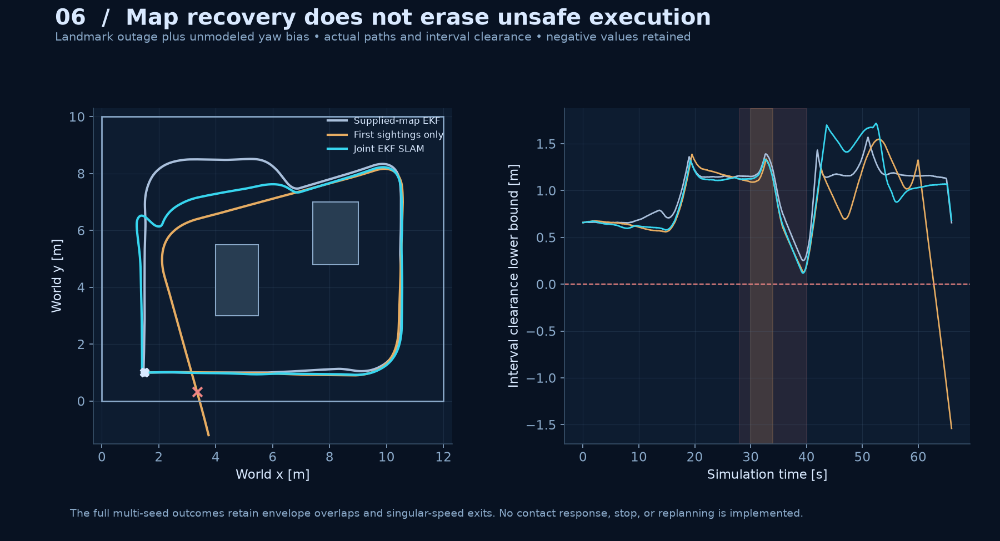

# Autonomous Explorer

A wheeled-rover learning project accompanying *Principles of Robot Autonomy*. We are building toward navigation, localization, mapping, exploration, and a return home—one reproducible milestone at a time.


**Milestone 04 · Landmark Mapping and SLAM.** The estimator starts with a rover prior and an empty landmark map. Range/bearing observations initialize features; later sightings update a joint belief over rover state and landmark positions. SLAM's pose estimate drives the existing tracking controller. Landmark coordinates are available only to the synthetic sensor, evaluation, and the explicitly labelled supplied-map baseline.

In the normal-sensing experiment, SLAM discovers all six landmarks and stays clear for all three seeds. Mean pose RMS is **0.149 m**, and final map RMS in the initial-prior frame averages **0.129 m**. A matched replay with revisits denied has **0.220 m** pose RMS. Outage experiments retain a collision and a low-speed exit; map recovery does not establish safe execution.

## Project status

| Milestone | Status | Evidence |
| :-- | :-- | :-- |
| 01 · Trajectory tracking foundations | Complete | [Walkthrough and gallery](MILESTONE_01.md) |
| 02 · Obstacle-aware navigation | Complete | [Walkthrough and gallery](MILESTONE_02.md) |
| 03 · Sensing and localization | Complete | [Walkthrough and gallery](MILESTONE_03.md) |
| 04 · Landmark mapping and SLAM | Complete | [Protocol](docs/slam.md), [saved evidence](results/slam/), [verification](docs/slam-verification.md) |
| 05 · Decision-making and exploration | Next | Choose goals from new evidence, handle localization health, and replan |
| Later · Return home and goal regulation | Planned | Return behavior and an explicit stop/park transition |

SLAM builds an initially unknown **point-landmark map**. The obstacle rectangles used for routing are supplied. The route is a prescribed loop; this milestone does not choose exploration goals or infer obstacle occupancy.

## Reproduce it

Use [uv](https://docs.astral.sh/uv/) and the committed lockfile:

```bash
uv sync --frozen --extra dev
uv run --frozen explorer slam-reproduce --results build/slam-reproduced/results --media build/slam-reproduced/media
```

The command plans and certifies a loop, runs **18 closed-loop executions** (three seeds × two conditions × three estimators), saves **six matched estimator replays**, and renders six figures and one GIF. Results directories must be empty or new.

```bash
uv run --frozen explorer slam-verify --results results/slam
uv run --frozen pytest -q
uv run --frozen ruff check src tests
uv run --frozen ruff format --check src tests
```

`slam-verify` checks hashes, recalculates metrics and clearance, regenerates tables, and replays every estimator from saved observations and applied commands. Re-render the evidence without rerunning the planner, sensors, or physical simulation:

```bash
uv run --frozen explorer slam-render --results results/slam --media build/slam-rendered
```

`slam-simulate` saves numerical evidence without rendering. [configs/slam.json](configs/slam.json) controls route, geometry, noise, initial prior, seeds, outages, and playback. The curated gallery expects the `nominal` and `landmark_outage` cases. Runtime dependencies remain NumPy, Matplotlib, and Pillow; a virtual-environment install with `python -m pip install -e '.[dev]'` also works.

Earlier experiments retain their original commands and evidence:

```bash
uv run --frozen explorer verify --results results/milestone
uv run --frozen explorer plan-verify --results results/navigation
uv run --frozen explorer localize-verify --results results/localization
```

## What changed

- **Unknown map:** EKF SLAM dynamically augments `(x, y, v, theta)` with a two-coordinate state for each newly observed feature. Landmark identities are supplied, but their positions are withheld.
- **Correlated uncertainty:** initialization includes pose-to-map and map-to-map covariance. The first reading initializes a feature once; it is not reused as an independent correction. Later observations can change the rover and correlated map together.
- **Revisits:** identified features returning after a five-second observation gap provide long-range corrections. A matched estimator replay denies those revisits while using the same recorded commands and observations.
- **Evaluation:** supplied-map EKF, first-sighting-only mapping, and joint SLAM all drive feedback from estimates. Only the supplied-map baseline receives surveyed landmark coordinates. No controller receives exact state.

The experiment uses a 66 s loop around two supplied freestanding rectangles, a 0.05 s control period, 10 Hz speed measurements, and 5 Hz range/bearing measurements with 4 m range and obstacle occlusion. It reuses the model, controller, continuous geometry tests, A*, reference certification, and sensor equations from the earlier milestones.

## Measured outcomes

Entries average per-run RMS over seeds 7, 19, and 41. Map RMS is the final error of discovered landmark coordinates in the initial-prior frame; it is not aligned to truth afterward. “Clear” requires a completed execution and a positive numerical interval clearance bound.

<!-- slam-summary:start -->
| Case | Estimator | Mean pose RMS [m] | Mean map RMS [m] | Mean tracking RMS [m] | Clear runs |
| :-- | :-- | --: | --: | --: | --: |
| nominal | known map | 0.0236 | supplied | 0.0254 | 3/3 |
| nominal | first sighting | 0.3116 | 0.3028 | 0.3119 | 3/3 |
| nominal | slam | 0.1489 | 0.1289 | 0.1512 | 3/3 |
| landmark outage | known map | 0.2134 | supplied | 0.2691 | 2/3 |
| landmark outage | first sighting | 1.7955 | 1.4833 | 1.7956 | 0/3 |
| landmark outage | slam | 0.5644 | 0.3167 | 0.6221 | 1/3 |
<!-- slam-summary:end -->

The [generated summary](results/slam/summary.md), [per-run outcomes](results/slam/outcomes.md), and [metrics](results/slam/metrics.json) retain all cases. An early-exit run contributes RMS over its recorded prefix and its last available map, not a fabricated completed horizon. In the outage case, SLAM seed 19 has 23 envelope-overlap samples; seed 41 exits the positive-speed domain. Both remain in the results. The supplied-map estimator also collides for seed 19 during the outage.

The six **estimator-only** replays are separate from those closed-loop comparisons. On the recorded nominal SLAM trajectories, denying revisits raises mean pose RMS from **0.149 m to 0.220 m** and final map pair-distance RMS from **0.030 m to 0.127 m**. [Replay metrics](results/slam/replay_metrics.json) preserve each seed. Absolute map RMS does not improve for every seed: the initial pose prior anchors the frame, and relative landmark observations do not supply independent absolute position or heading.

## Visual gallery

All empirical figures and replay frames use saved evidence. Crosses show evaluation truth; they are not observations supplied to SLAM. Shaded obstacle geometry is supplied for routing.



**01 · Joint mapping.** Both filters begin without landmark coordinates. Reobservations constrain the joint map and motion belief. Ellipses show approximate 95% map marginals. [SVG](media/slam/01_mapping.svg).



**02 · Map growth.** Landmark means appear after their first sensor observation. Equal-scale snapshots retain discovery order and the actual trail.



**03 · Two errors.** Localization compares estimate with truth; tracking compares actual motion with the reference. Different closed-loop estimators produce different trajectories and visibility.



**04 · Revisit ablation.** These replays use identical recorded motion and observations. They isolate estimator behavior without claiming a counterfactual rover trajectory. [SVG](media/slam/04_revisits.svg).



**05 · Correlated belief.** The dense joint covariance retains relations between rover and map variables. A finite initial rover prior anchors the coordinate frame; covariance is a model belief, not a clearance certificate.



**06 · Retained failures.** Landmark corrections cannot undo earlier envelope overlaps. The full study also includes a partial run that exits the controller's speed domain. [SVG](media/slam/06_outage_clearance.svg).

## Learn and inspect

Read the [SLAM experiment and equations](docs/slam.md), [primary-source notes](docs/slam-sources.md), and [verification record](docs/slam-verification.md). The book anchor is [Chapter 14 · Simultaneous Localization and Mapping](https://porabook.com/book/slam/).

| Location | Responsibility |
| :-- | :-- |
| [slam.py](src/autonomous_explorer/slam.py) | Inverse observations, dynamic state augmentation, full covariance, and joint updates |
| [slam_evidence.py](src/autonomous_explorer/slam_evidence.py) | Planned loop, closed-loop comparisons, estimator replays, metrics, and evidence audits |
| [slam_render.py](src/autonomous_explorer/slam_render.py) | Saved-data mapping figures and animation |
| [tests/test_slam.py](tests/test_slam.py) | Independent Jacobians, correlations, causal replay, branch cuts, failures, and provenance |

Current assumptions include known feature identities, static point landmarks, a supplied obstacle map, synchronous sensors, a local initial-pose prior, and kinematic actuation. This is an online EKF over current rover state and landmarks; it does not optimize historical poses. Feature extraction, ambiguous data association, occupancy mapping, exploration goals, runtime collision avoidance, and hardware remain future work. The endpoint is still moving, with no parking transition.

The next milestone is **decision-making and exploration**, with localization-health handling motivated by the retained outage failures. The [optional CI template](docs/checks-workflow.yml) covers all four milestones. Original code and figures use the [MIT license](LICENSE); study sources are attributed separately.
