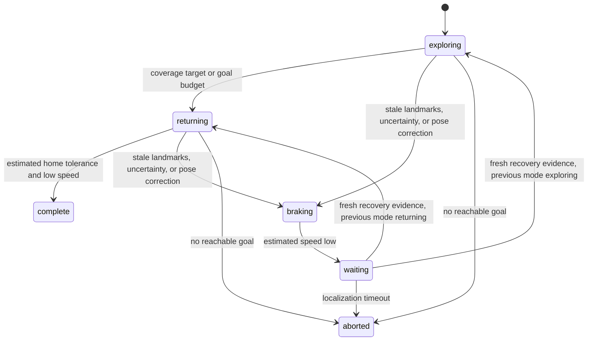

# Milestone 05 · Decision-making and viewpoint exploration

The rover now chooses observation goals online and coordinates SLAM, planning, motion, localization recovery, and return. The policy consumes a belief and accepted-observation timing. Actual state, true landmark coordinates, plant disturbances, and the outage schedule are excluded from its interface.

## Scope

The routing world and candidate observation viewpoints are supplied. Point-landmark positions are initially unknown to SLAM. The exploration measure is a **modelled visibility footprint over the supplied free-space grid**, not a learned occupancy map or a guarantee that an actual sensor observed every covered point. This milestone adds goal decisions and recovery behavior; unknown obstacle occupancy is the next representation to build.

[configs/exploration.json](../configs/exploration.json) inherits the SLAM experiment settings and embeds the resolved configuration in saved evidence. It starts at `(1.5 m,1.0 m)` with zero stored speed and uses a maximum 160 s horizon at 20 Hz. The planner uses a 0.5 m lattice. Candidate viewpoints are static positions, not a prescribed visit order.

Three seeds and three conditions are run with health supervision enabled or disabled, producing 18 physical executions. All modes share pre-generated independent plant, speed-sensor, and feature-sensor noise arrays for a seed. Their resulting trajectories and sensor values can diverge. Nominal behavior matches exactly between supervisor modes until any intervention becomes necessary.

Landmark readings disappear on `[14,22) s` for a temporary outage and `[14,160) s` for persistent loss. Both add a +0.12 rad/s yaw bias on `[14,18) s`. Speed readings continue. These schedules are used by sensor synthesis and plant integration only; neither the mission policy nor SLAM reads them.

## Belief and observation evidence

The existing EKF SLAM starts with its four-state rover prior and no map features. Its current rover mean/covariance, learned landmark means/marginals, and timestamp of the last accepted landmark packet form the mission belief. A speed reading alone does not refresh landmark health. An accepted first sighting or later correction does.

Replay tests remove true landmark coordinates and outage schedules and replace actual states/disturbances with unrelated values. The reconstructed SLAM states, control requests, coverage history, goals, routes, and transition events remain identical. The supplied obstacle world remains available because routing and projected visibility explicitly depend on it.

## Coverage and goal utility

A 1 m grid samples free points in the supplied static world. When a landmark packet is accepted, the mission projects a 3.5 m visibility footprint from its **estimated** position, rejecting sight lines blocked by supplied rectangles. Covered cells are accumulated monotonically. Frames without accepted landmark evidence add no coverage. This is a geometric observation opportunity proxy; it can be biased by pose error and cannot certify sensed occupancy or feature completeness.

For every unvisited reachable candidate, the policy computes:

```text
utility = uncovered visible cells
        + map_uncertainty_weight × visible estimated landmark covariance traces
        − distance_weight × checked route length
```

Estimated landmark visibility uses learned coordinates and the supplied obstacle map. True feature positions and unobserved feature counts do not enter the utility. Candidates are compared deterministically, with lower candidate ID breaking ties. The full utility components and selected ID are saved at each decision. This is greedy selection, not dynamic programming, a POMDP solution, or an optimal information-gain policy.

Exploration ends when model coverage reaches the configured target (92%) or five viewpoints have been completed. The policy then selects the known initial position as its return goal. Reaching a viewpoint requires low estimated speed, so goals are not consumed solely by crossing their position tolerance while moving.

## Checked routes and replanning

The rover position estimate is generally off the planner lattice. A straight connection to the goal is accepted if the entire segment is free in the conservative configuration space. Otherwise, nearby grid nodes are considered in deterministic distance order, with an explicitly checked continuous connector from the estimate. A* finds a route from a reachable connector, and validated shortcuts simplify it. The planner never silently replaces the estimate with a snapped start point.

The configuration-space inflation uses the enclosing rover disk plus a 0.40 m fixed planning margin. Every returned route starts at the logged position estimate, and every segment is continuously tested against inflated obstacles and inward world boundaries. A* is optimal on its selected graph; connector choice, greedy shortcuts, and viewpoint utility do not imply continuous or mission optimality.

Following a large position correction (>0.5 m) or health intervention, the old route is discarded. The rover brakes before obtaining a new checked route from its updated estimate. A goal already selected before the pause is retained unless it has been completed. If no selected/candidate route is reachable from the estimated state, the mission records `no_reachable_goal` at low estimated speed.

## Motion at zero speed

The original flatness controller remains unchanged for the earlier milestones. This mission uses a separate heading/speed waypoint law defined at zero:

```text
heading_error = wrap(bearing_to_waypoint − estimated_heading)
v_target = min(cruise_speed, distance_gain × waypoint_distance)
v_target = 0 if |heading_error| > turn_threshold
acceleration_request = speed_gain × (v_target − estimated_speed)
yaw_request = heading_gain × heading_error
```

At an intermediate or final waypoint within 0.16 m, the rover brakes until absolute estimated speed is at most 0.04 m/s. It then advances the path index, chooses the next goal, or reports completion. Commands are clipped to the original ±0.5 m/s² and ±1.2 rad/s limits and held for RK4 integration.

Braking requests `−speed_gain × estimated_speed` with zero yaw rate. This remains defined through zero and permits small reverse transients caused by estimation/noise; speed is not clamped or reset in the plant. The kinematic model's speed-offset disturbance still affects translation even at stored `v=0`. The motion law is a practical waypoint controller, not a certified trajectory tube, exact stop model, or final-heading parking controller.

## Mission state machine

The policy uses these states:



Health supervision declares stale localization when accepted-landmark age exceeds 2 s, or uncertain position when the largest position standard deviation exceeds 0.8 m. It also identifies a nonfinite belief. These are heuristic conditions, not detectors with proven coverage of arbitrary estimation failures. The normal and comparison policies both brake/replan after large pose corrections; the comparison disables the age/covariance supervision.

On intervention, the mission saves its previous exploration/return mode, discards the path, and brakes. Once estimated speed is low, it waits. Recovery requires three accepted fresh packets under good health and low estimated speed; a renewed unhealthy condition resets the count. Ordinary control ticks without packets do not count as recovery evidence. A 14 s timeout from the intervention produces `localization_timeout`. There is no timeout-based assumption that observations have recovered.

In the released runs, intervention occurs at 15.85 s, and persistent loss terminates at 29.85 s. Temporary loss allows recovery after the sensor resumes and sufficient packets arrive, followed by replanning and return. Every transition and reason remains in JSON metadata.

## Mission decisions versus physical outcomes

The `complete` state is a decision based on estimated home position and speed. Actual-state evaluation independently checks final distance ≤0.30 m and actual absolute stored speed ≤0.05 m/s. An aborted mission does not claim arrival. Positive numerical clearance is another separate property and can hold for a mission that deliberately aborts away from home.

All six supervised nominal/temporary-outage runs meet the home audit and retain positive interval clearance. They end 0.114–0.167 m from actual home. Their actual final absolute speeds are 0.024–0.042 m/s, which meet the evaluation tolerance but are not an exact stationary parking result.

All three supervised persistent-loss runs abort and retain positive clearance; final actual absolute stored speeds are below 0.004 m/s. All three unsupervised persistent-loss runs report `complete` but fail the home audit, ending 2.097–3.979 m away and violating the collision envelope. Their low stored speed does not validate their position estimate.

All three unsupervised temporary-loss runs abort with no reachable plan after pose corrections; seed 41 also has an envelope violation. The other two remain clear despite incomplete missions. None of these outcomes is relabelled as successful arrival.

The interval clearance audit uses actual saved states and the original enclosing-disk travel bound. It is conditioned on numerical integration endpoints and omits a formal global RK4 error enclosure. Three fixed seeds establish reproducibility of the stated experiments, not arbitrary-disturbance robustness. No true-state clearance is fed back into the mission.

## Evidence and replay

`explorer explore-reproduce` saves a fresh result set and gallery. `explore-simulate` omits rendering. `explore-render` verifies the saved evidence, replays the estimation/decision equations, and renders without a new plant or sensor run. `explore-verify` checks hashes, summary, metrics, actual clearance, SLAM posterior histories, goal scores, paths, transitions, requested controls, and controller-state provenance.

Each run contains N actual/estimated/controller states and N−1 commands and disturbances. Full joint snapshots follow the SLAM evidence convention. Additional arrays record supervisor state codes, selected goal IDs, monotone coverage masks, cell coordinates, accepted-landmark age, and pose-correction size. Metadata stores the terminal reason, horizon, goal/plan counts, transition events, path coordinates, and every candidate utility. Logs end at actual terminal decisions; shorter animation panels hold their last recorded sample with an explicit annotation.

The previous four milestones' evidence is preserved. The next milestone requires an occupancy sensor/model and mapping representation so decisions can depend on newly learned obstacle/free-space evidence instead of the supplied world. Precise stationary final-pose regulation remains a separate task.
